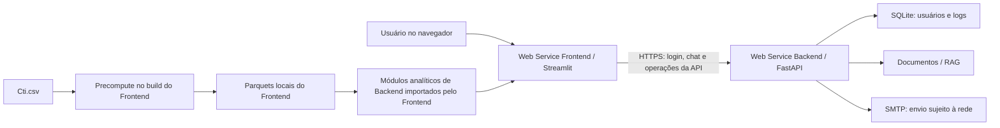
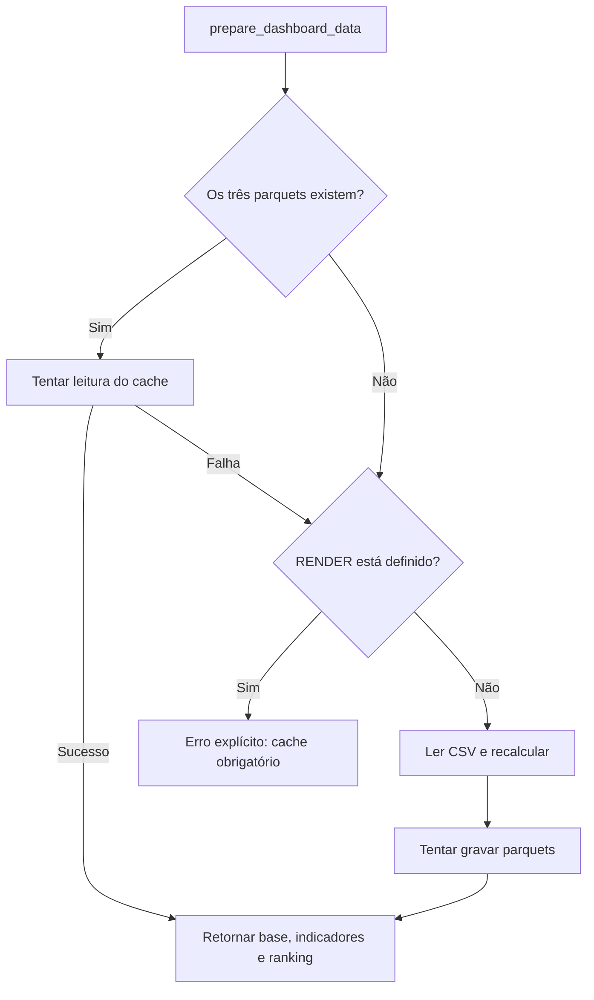

# Documentação Técnica — Dashboard Financeiro CTI

**Projeto Interdisciplinar de Ciência de Dados — Entrega 2**  
**Revisão documental:** 13 de outubro de 2026  
**Escopo:** arquitetura, dados, indicadores, publicação e limitações da implementação presente no repositório.

Este documento descreve o sistema implementado, distinguindo funcionalidades ativas, recursos de integração disponíveis e propostas de evolução. As referências ao código são relativas à pasta `PI4/`. As condições dos provedores foram consultadas na data desta revisão; a existência de um blueprint não comprova que os serviços estejam publicados ou operacionais.

## Sumário

1. [Visão geral e arquitetura do sistema](#1-visão-geral-e-arquitetura-do-sistema)
2. [Origem e pipeline de dados](#2-origem-e-pipeline-de-dados)
3. [Dicionário de indicadores e fórmulas matemáticas](#3-dicionário-de-indicadores-e-fórmulas-matemáticas)
4. [Limitações técnicas e decisões de arquitetura — Transparency Notes](#4-limitações-técnicas-e-decisões-de-arquitetura--transparency-notes)
5. [Reprodução, verificação e rastreabilidade](#5-reprodução-verificação-e-rastreabilidade)
6. [Referências externas](#6-referências-externas)

## 1. Visão geral e arquitetura do sistema

### 1.1. Objetivo e contexto analítico

O Dashboard Financeiro CTI permite explorar cenários de planejamento econômico-financeiro de uma concessão de infraestrutura. O painel articula demonstrações de resultado, balanço patrimonial e fluxo de caixa, com filtros de cenário e ano e visões destinadas a CEO, CFO, acionistas e Poder Concedente.

A base representa trajetórias simuladas em um horizonte de 12 anos, conforme o material de domínio em [Objeto da concessão e base CTI](Backend/documentos/visao_geral/01_objeto_e_base.md). Os resultados devem ser interpretados como análise de cenários, sem assumir que correspondam a demonstrações históricas auditadas. O repositório contém a base utilizada, mas não estabelece integralmente a autoria, a data de extração, a licença ou o algoritmo original de geração dos cenários. Esses elementos de proveniência devem acompanhar a base em uma publicação científica definitiva.

### 1.2. Separação de responsabilidades

| Camada | Tecnologia e entrada | Responsabilidades |
| --- | --- | --- |
| Interface | Streamlit — `Frontend/app.py` | Sessão visual, filtros, gráficos, seleção de perfis e download de relatórios |
| Cliente HTTP | `Frontend/src/models/api_client.py` | Comunicação com a API, tratamento de respostas HTTP, timeout e indisponibilidade |
| API | FastAPI — `Backend/main.py` | Rotas de autenticação, usuários, saúde, chat e e-mail |
| Serviços analíticos | `Backend/services/` e `Backend/metrics/` | Preparação dos dados, indicadores, rankings, risco e geração de relatórios |
| Acesso a dados | `Backend/data_loader/` e `Backend/db/` | CSV/Parquet, recursos PostgreSQL e persistência de usuários/logs |
| Assistente | Serviços de chat e RAG | Recuperação de documentos e respostas apoiadas no contexto financeiro |

A separação de publicação é por processo e por serviço. O Frontend ainda importa módulos Python de `Backend` para cálculos e relatórios locais. Portanto, o sistema possui dois serviços executáveis independentes, mas conserva dependências de código e dados no monorepositório. Não há uma API HTTP exclusiva para todo o processamento do dashboard.



O PostgreSQL/Supabase não aparece como fonte ativa no diagrama: sua integração está disponível no código, mas desativada pela constante `USAR_SUPABASE = False` em [data_loader/db.py](Backend/data_loader/db.py).

### 1.3. Organização do projeto

```text
PI4/
├── Backend/
│   ├── main.py                 # Entrada FastAPI e registro de rotas
│   ├── runtime.py              # Lifespan, logs e CORS
│   ├── routers/                # Contratos HTTP
│   ├── data_loader/            # Leitores CSV e SQL
│   ├── db/                     # Usuários, autenticação e logs
│   ├── metrics/                # Fórmulas financeiras e comerciais
│   ├── services/               # Pipeline, cache, risco, RAG e relatórios
│   ├── scripts/                # Precompute e migração de dados
│   ├── tests/                  # Contratos e regressões
│   ├── documentos/             # Material de referência do assistente
│   ├── Cti.csv                 # Base longa de cenários
│   └── cache/                  # Parquets e SQLite local
├── Frontend/
│   ├── app.py                  # Entrada Streamlit
│   ├── src/config/             # URL da API, caminhos e configurações
│   ├── src/controllers/        # Estado e coordenação da interface
│   ├── src/models/             # Cliente HTTP e modelos de apresentação
│   ├── src/views/              # Telas e visões por perfil
│   └── requirements.txt        # Inclui dependências dos módulos compartilhados
├── README.md                   # Instruções de execução
└── DOCUMENTATION.md            # Este documento
```

### 1.4. Infraestrutura de publicação na Render

O [blueprint da raiz](../render.yaml) define `cti-api` e `cti-frontend` como Web Services Python no plano gratuito. Ambos usam **Root Directory `PI4`**. Essa escolha mantém os módulos e dados compartilhados acessíveis ao dashboard: a Render não disponibiliza arquivos externos ao Root Directory durante build ou execução. [Render — Monorepo Support](https://render.com/docs/monorepo-support).

| Serviço | Build Command | Start Command | Health check |
| --- | --- | --- | --- |
| Backend | `pip install -r Backend/requirements.txt` | `cd Backend && uvicorn main:app --host 0.0.0.0 --port $PORT` | `/api/v1/health` |
| Frontend | `pip install -r Frontend/requirements.txt && python Backend/scripts/precompute_cache.py` | `cd Frontend && streamlit run app.py --server.port $PORT --server.address 0.0.0.0` | `/_stcore/health` |

O `$PORT` é fornecido pela plataforma; cada processo escuta em `0.0.0.0`. O build do Frontend gera seus próprios parquets. Os serviços não compartilham disco: gerar arquivos no Backend não os disponibiliza automaticamente ao Frontend.

A API também pode ser publicada isoladamente com Root Directory `PI4/Backend`, build `pip install -r requirements.txt` e start `uvicorn main:app --host 0.0.0.0 --port $PORT`. O Frontend deve manter `PI4` enquanto depender dos módulos irmãos.

### 1.5. Conexão, configuração e CORS

Em [configuração do Frontend](Frontend/src/config/__init__.py), a precedência para o endereço da API é:

1. `BACKEND_URL`;
2. `API_URL`;
3. `CTI_API_URL`;
4. endereço local composto por `API_HOST` e `API_PORT`, com padrão `http://localhost:8000`.

URLs públicas configuradas são preservadas mesmo quando `RENDER` está definido. Arquivos `.env` do Frontend e de `PI4` podem fornecer configuração local; variáveis já presentes no processo têm precedência.

No Backend, `main.py` chama `configure_application(app)` de [runtime.py](Backend/runtime.py), que instala `CORSMiddleware`. `FRONTEND_URL` permite uma origem explícita; `CORS_ORIGINS` permite uma lista separada por vírgulas. A expressão padrão também admite origens locais e HTTPS em `*.onrender.com`. O cliente HTTP normalmente executa no servidor Streamlit; CORS é uma política de navegador e não substitui autenticação ou conectividade de rede.

## 2. Origem e pipeline de dados

### 2.1. Fonte primária: `Cti.csv`

O arquivo [Cti.csv](Backend/Cti.csv) armazena contas financeiras em formato longo, sem cabeçalho. Cada registro combina período, cenário, conta e valor. O leitor usa vírgula como delimitador; valores brasileiros com vírgula decimal aparecem delimitados por aspas no arquivo.

| Campo | Tipo lógico | Descrição e tratamento |
| --- | --- | --- |
| `ANO` | Texto | Período, por exemplo `Ano 1` |
| `CENA` | Texto/categoria | Identificador do cenário, por exemplo `Total Cen_00001` |
| `CONTA` | Texto/categoria | Rubrica contábil; espaços redundantes são normalizados |
| `VALOR` | Número real | Valor monetário ou premissa; conversão de notação brasileira |
| `ano_num` | Inteiro derivado | Número extraído de `ANO`, utilizado em filtros e agrupamentos |

Os prefixos identificam famílias de demonstrativos: `BAL -` para balanço patrimonial, `DRE -` para resultado e `FLU -` para fluxo de caixa. Algumas linhas podem conter premissas ou conta vazia; nem todos os registros devem ser interpretados como uma rubrica monetária.

Os sinais contábeis são preservados. Custos e tributos negativos representam reduções de resultado. A substituição indiscriminada por módulos alteraria a DRE; o valor absoluto é aplicado apenas nas fórmulas que explicitamente o exigem.

### 2.2. Extração, transformação e materialização

O processamento é implementado em [csv_reader.py](Backend/data_loader/csv_reader.py), [precompute_cache.py](Backend/scripts/precompute_cache.py) e [financial_kpis.py](Backend/metrics/financial_kpis.py).

1. **Leitura:** `pandas.read_csv` atribui as quatro colunas e lê blocos de até 120.000 registros.
2. **Normalização:** remove espaços redundantes de `CONTA`; converte pontos de milhar e vírgulas decimais de `VALOR`; extrai `ano_num`.
3. **Compactação:** converte cenário, conta e ano textual em categorias; armazena `ano_num` como `int8` e valores como `float64`. Valores não numéricos acabam preenchidos com zero na etapa de otimização, uma decisão relevante para qualidade dos dados.
4. **Cálculo:** mapeia contas canônicas, consolida indicadores por cenário/ano e produz o ranking de cenários.
5. **Materialização:** grava `cti_limpo.parquet`, `indicadores.parquet` e `ranking.parquet` em `Backend/cache/`.
6. **Consumo:** o dashboard lê os parquets e utiliza cache de resultados do Streamlit para evitar processamento repetido.

O precompute recusa uma base vazia ou com menos de 1.000 linhas. Essa verificação detecta incompletude grosseira, mas não comprova integridade contábil. O leitor também pode reutilizar `cti_limpo.parquet` quando seu timestamp é igual ou posterior ao CSV; timestamp não equivale a uma verificação criptográfica de conteúdo.

A leitura em blocos reduz o tamanho de cada operação de entrada, mas as partes são concatenadas em memória. Logo, o processamento não possui consumo de memória constante. A opção pelo Parquet reduz trabalho de parsing em execução e concentra o cálculo inicial na fase de build.

### 2.3. Integração PostgreSQL/Supabase disponível

[sql_reader.py](Backend/data_loader/sql_reader.py) implementa consultas à tabela `cti_dados`, com filtros parametrizados, agregação por ano/conta e pivoteamento de rubricas no PostgreSQL. A estrutura de migração utiliza:

```sql
CREATE TABLE IF NOT EXISTS cti_dados (
    id BIGSERIAL PRIMARY KEY,
    "ANO" TEXT,
    "CENA" TEXT,
    "CONTA" TEXT,
    "VALOR" DOUBLE PRECISION,
    ano_num INTEGER
);
```

O script [migrar_para_supabase.py](Backend/scripts/migrar_para_supabase.py) importa o CSV em lotes de 10.000 registros. Sua operação inclui `TRUNCATE TABLE cti_dados RESTART IDENTITY`: é uma recarga integral, não uma atualização incremental. A execução exige destino explicitamente conferido e uma política de recuperação dos dados. Não faz parte do build atual.

A conexão analítica usa SQLAlchemy e `psycopg2`, exige SSL e inclui timeout de conexão de 12 segundos, `pool_pre_ping` e reciclagem de conexões. As URLs podem ser fornecidas por `DATABASE_URL_POOLER`, `SUPABASE_POOLER_URL`, `DATABASE_URL` e `SUPABASE_DB_URL`. Há resolução de IPv4 e seleção de candidatos configurados; o sistema não transforma um endpoint exclusivamente IPv6 em IPv4.

As operações SQL tentam até três vezes em determinados erros de conexão, descartando o engine antes de tentar novamente e usando espera proporcional à tentativa. Erros considerados estruturais, como DNS e rede inacessível, interrompem a repetição antecipadamente. Após esgotar as tentativas, o leitor propaga o erro: **não existe, nessa função, uma troca automática para CSV**.

**Estado atual:** `USAR_SUPABASE = False` desativa o acesso remoto tanto no caminho analítico quanto na seleção de banco da autenticação. Informar uma URL no ambiente não ativa, por si só, o Supabase. Reativar a integração exige revisão do código e do fluxo de consumo, seguida de testes; o dashboard atual chama o pipeline local.

### 2.4. Resiliência e fallback efetivamente implementados

A resiliência deve ser entendida em três mecanismos distintos:

| Mecanismo | Condição | Comportamento | Limite |
| --- | --- | --- | --- |
| Independência da fonte remota | Fluxo atual com Supabase desativado | Dashboard usa snapshot local em Parquet | Não reflete mudanças remotas automaticamente |
| Fallback analítico local | Parquets ausentes ou ilegíveis fora da Render | Lê CSV, recalcula indicadores e tenta gravar cache | Exige CSV íntegro e memória suficiente |
| Fallback de autenticação | Inicialização PostgreSQL indisponível, quando habilitada | `init_db()` muda para SQLite e cria tabelas | Banco local não replica dados remotos nem garante persistência |

Em [dashboard_pipeline.py](Backend/services/dashboard_pipeline.py), o fluxo é:



Na Render, a leitura do CSV em runtime é deliberadamente bloqueada no fluxo padrão para evitar uma carga pesada. O precompute do build utiliza `forcar_ficheiro=True`. Assim, a disponibilidade do dashboard em nuvem depende da geração e legibilidade dos três artefatos no próprio serviço do Frontend.

[dashboard_cache.py](Backend/services/dashboard_cache.py) possui ainda uma reconstrução parcial do formato longo a partir de indicadores quando o parquet bruto não está disponível, desde que indicadores e ranking possam ser lidos. Contudo, a verificação inicial do pipeline exige os três arquivos; essa reconstrução não constitui uma garantia geral de recuperação de cache incompleto na Render. Como nem todas as contas originais podem ser reconstruídas, DRE e break-even podem perder informação nesse caminho parcial.

O [bootstrap do Frontend](Frontend/src/controllers/bootstrap.py) trata falhas, tenta reler um cache disponível e apresenta mensagem de erro quando a recuperação não é possível. Em [database.py](Backend/db/database.py), o SQLite de usuários e logs fica em `Backend/cache/cti_auth.db`; o fallback é realizado na inicialização, sem failover transparente contínuo de toda transação.

A estratégia melhora a continuidade analítica diante da indisponibilidade de uma base externa, mas **não implementa alta disponibilidade formal**: não há réplicas, failover distribuído ou SLA estabelecido pelo projeto.

### 2.5. Qualidade, atualização e rastreabilidade

O diretório [audit/](Backend/audit/) contém verificações estruturais, de duplicidade e totais de controle, com chave de negócio `ANO`, `CENA`, `CONTA`. Esses recursos devem ser executados e seus resultados arquivados quando se atualiza a base; sua existência não comprova que todos os dados passaram na auditoria.

Recomenda-se registrar origem, versão e hash do CSV, data de geração do cache, versão do código e resultados de auditoria para cada entrega. Na implementação atual, o cache representa um snapshot; não existe sincronização agendada ou atualização em tempo real do Supabase para os parquets do dashboard.

## 3. Dicionário de indicadores e fórmulas matemáticas

### 3.1. Convenções e agregação

Considere um cenário e um ano selecionados. Grandezas monetárias são expressas em reais; razões são adimensionais. Os percentuais são armazenados como frações: `0,25` representa `25%`.

Em `build_dre`, as contas são agregadas por ano. Para cenário específico, a operação é soma; para “Todos”, é média por ano/conta. A média entre cenários descreve uma trajetória média e não a soma do patrimônio ou resultado de empresas distintas.

A média de razões geralmente difere da razão das médias:

$$
\frac{1}{n}\sum_{i=1}^{n}\frac{x_i}{y_i}
\neq
\frac{\frac{1}{n}\sum_{i=1}^{n}x_i}{\frac{1}{n}\sum_{i=1}^{n}y_i}.
$$

Isso é relevante ao comparar cards consolidados, tabelas anuais e indicadores calculados sobre a DRE média. Contas ausentes podem ser preenchidas com zero; denominadores nulos são substituídos por valores ausentes em várias fórmulas. Um zero mostrado no resumo nem sempre comprova ausência econômica da grandeza.

### 3.2. Receita Líquida

**Conceito:** receita operacional após tributos incidentes sobre faturamento.

Seja $R$ a conta `DRE - Receita` e $T$ a conta `DRE - Tributos`, preservando seu sinal:

$$
RL = R + T.
$$

Como $T$ costuma ser negativo, a soma reduz a receita bruta. Exemplo didático: $R=1.000.000$ e $T=-100.000$ produzem $RL=900.000$.

**Implementação:** `build_dre` em [financial_kpis.py](Backend/metrics/financial_kpis.py). A Receita Líquida é usada no break-even e nas margens da visão DRE; outros indicadores do sistema podem utilizar a receita bruta, conforme sua fórmula específica.

### 3.3. EBITDA

**Conceito:** resultado antes de juros, tributos sobre o lucro, depreciação e amortização. É uma medida de desempenho operacional, sem equivaler ao fluxo de caixa: não incorpora, por si só, investimentos e variações de capital de giro.

**Regra implementada:** o EBITDA é lido diretamente de `DRE - EBITDA`, não recalculado a partir de todas as despesas.

Para explicar a composição da cascata, seja $C$ o custo com sinal contábil:

$$
MB = RL + C,
\qquad OPEX_{\text{assinado}} = EBITDA - MB,
$$

$$
EBITDA = RL + C + OPEX_{\text{assinado}}.
$$

Quando custos e OPEX são despesas negativas, a forma econômica equivalente é receita líquida menos custos e despesas operacionais em magnitude. A identidade acima reconcilia a apresentação com a conta informada; não é uma validação independente do EBITDA.

Na visão DRE do CEO:

$$
Margem_{EBITDA} = \frac{EBITDA}{RL}.
$$

### 3.4. EBIT

**Conceito:** resultado operacional após os efeitos de depreciação e amortização, antes do resultado financeiro e da tributação do lucro.

**Regra implementada:**

$$
EBIT = \text{conta “DRE - Resultado Operacional”}.
$$

A relação conceitual usual $EBIT = EBITDA - D\&A$ pressupõe despesas em magnitude e ausência de outros ajustes operacionais. O programa utiliza a conta informada de EBIT e não força essa identidade. Divergências precisam ser conciliadas com as rubricas de origem, incluindo outros resultados operacionais.

Na visão DRE:

$$
Margem_{EBIT} = \frac{EBIT}{RL}.
$$

### 3.5. Lucro Líquido

**Conceito:** resultado final do período após resultado financeiro e tributos sobre o lucro.

Seja $LL_{inf}$ a conta `DRE - Resultado Líquido`, $RF$ o resultado financeiro e $IRCS$ o imposto de renda e contribuição social, com seus sinais originais:

$$
LL =
\begin{cases}
LL_{inf}, & |LL_{inf}| > 10^{-9};\\
EBIT + RF + IRCS, & \text{caso contrário}.
\end{cases}
$$

O fallback também ocorre quando o lucro informado é economicamente zero; o código não distingue automaticamente esse caso de uma conta ausente ou residual. O LAIR/EBT apresentado é lido de `DRE - Resultado Antes do Imposto de Renda`.

**Exemplo didático:** $EBIT=200.000$, $RF=-30.000$ e $IRCS=-50.000$ resultam em lucro derivado de $120.000$. Esse exemplo não constitui um resultado observado da base.

### 3.6. Ponto de Equilíbrio — Break-Even

**Conceito:** receita necessária para que a margem de contribuição cubra os custos fixos adotados pelo modelo.

A implementação `build_break_even` define:

$$
CV = |\text{DRE - Custos}|,
$$

$$
CF = |\text{Outros Resultados Operacionais}|
+ |\text{Depreciação e Amortização}|
+ |\text{Despesas Financeiras}|,
$$

$$
m = \frac{RL-CV}{RL},
\qquad BE = \frac{CF}{m}.
$$

$BE$ é expresso em reais e $m$ é a margem de contribuição em fração. A classificação de custos é uma aproximação específica: inclui despesa financeira e depreciação nos custos fixos e aplica módulo a outros resultados operacionais. Não representa exclusivamente um ponto de equilíbrio operacional de caixa.

**Domínio de interpretação:** com $RL>0$ e $m>0$, o equilíbrio tem interpretação usual. Receita ou margem nula produz valores ausentes; margem negativa pode produzir um break-even negativo na expressão implementada, sem significar viabilidade econômica. Não há bloqueio universal de margens negativas nesse cálculo.

### 3.7. Margem de Segurança

**Conceito:** distância relativa entre receita realizada/projetada e receita de equilíbrio.

$$
MS = \frac{RL-BE}{RL}.
$$

Para $RL>0$ e equilíbrio economicamente válido, $MS>0$ indica receita acima do equilíbrio, $MS=0$ indica equilíbrio e $MS<0$ indica insuficiência. Exemplo didático: $RL=1.000.000$, $CV=600.000$ e $CF=200.000$ resultam em $m=0,40$, $BE=500.000$ e $MS=50\%$.

O gráfico consolidado utiliza a média do break-even anual e a média da margem de contribuição, ajustando a linha de custos para que sua interseção corresponda ao break-even mostrado. Essa apresentação não equivale necessariamente a calcular $CF$ médio dividido por $m$ médio.

### 3.8. Eficiência comercial: LTV, CAC e LTV/CAC

As fórmulas estão em [commercial_kpis.py](Backend/metrics/commercial_kpis.py).

Sejam $I$ o investimento em vendas e marketing, $N$ os novos clientes adquiridos, $TM$ o ticket médio, $M$ a retenção em meses e $m$ a margem de contribuição obtida do break-even:

$$
CAC = \frac{I}{N},
\qquad LTV = TM\cdot m\cdot M,
\qquad Q = \frac{LTV}{CAC}.
$$

O CAC representa o gasto médio de aquisição; o LTV aproxima a contribuição econômica durante a retenção. A multiplicação por meses exige interpretar o ticket na mesma periodicidade mensal. Se a premissa de ticket tiver outra periodicidade, deve ser ajustada antes de interpretar o resultado.

As premissas são buscadas por aliases de contas na base longa e agregadas por média anual. Séries encontradas são alinhadas aos anos e preenchidas para frente e para trás. Quando uma premissa não está disponível, os padrões são:

| Premissa | Valor padrão | Unidade |
| --- | --- | --- |
| Ticket médio | 4.500 | R$/cliente por período compatível com meses |
| Retenção | 10 | Meses |
| Investimento em vendas e marketing | 100.000 | R$ |
| Novos clientes | 1.000 | Clientes |

Com essas premissas, $CAC=100$. O LTV ainda depende de $m$; portanto, não existe um LTV padrão único. Novos clientes ou CAC nulos são tratados como ausentes para evitar divisão por zero. No resumo, resultados vazios ou médias ausentes podem aparecer como zero.

O card consolidado calcula separadamente a média de LTV, a média de CAC e a média das razões anuais. A razão exibida não é necessariamente a divisão dos dois valores médios dos cards.

**Limitações:** o indicador é uma aproximação financeira, sem análise de coortes, desconto a valor presente, distribuição individual de churn ou garantia de medição real de aquisição. Premissas padrão devem ser declaradas na interpretação acadêmica. $Q>1$ sugere contribuição superior ao gasto de aquisição sob essas hipóteses; não comprova, isoladamente, lucratividade total.

### 3.9. Razão de reinvestimento e retenção de lucro

Na visão de acionistas, `build_financial_statement` adota `PAYOUT = 0.35` e calcula:

$$
LL^{+} = \max(LL,0),
\qquad Dividendos = 0,35\cdot LL^{+},
$$

$$
Retido = LL^{+}-Dividendos = 0,65\cdot LL^{+}.
$$

Para lucro positivo, a razão de retenção implícita é:

$$
b = \frac{Retido}{LL^{+}} = 0,65 = 65\%.
$$

O painel apresenta os montantes de dividendos e lucro retido; a razão acima documenta a política implícita e não uma coluna universal já calculada no código. Em prejuízo ou lucro zero, ambos os montantes são zero e a razão fica indefinida, sem interpretação automática de 65%.

“Reinvestimento” nessa visão corresponde à retenção contábil hipotética do lucro. Não comprova aplicação efetiva em ativos ou aquisição de clientes. Como medida distinta, a visão do concedente calcula intensidade de investimento:

$$
Intensidade_{CAPEX} = \frac{CAPEX}{RL},
\qquad CAPEX = |\text{FLU - Investimentos}|.
$$

Essa razão mede investimentos sobre receita e não substitui a taxa de retenção ou o investimento comercial utilizado no CAC.

## 4. Limitações técnicas e decisões de arquitetura — Transparency Notes

### 4.1. IPv6 e acesso a bases externas

O módulo de conexão foi projetado para selecionar endpoints com resolução IPv4. Um host `db.<projeto>.supabase.co` pode resolver apenas para IPv6; nesse caso, uma rede sem rota IPv6 não consegue estabelecer a conexão TCP, ainda que credenciais e SSL estejam corretos. A documentação da Render registra ausência de suporte a endereços IPv6; a documentação do Supabase descreve a conexão direta IPv6 e alternativas IPv4 por pooler. [Render — Troubleshooting](https://render.com/docs/troubleshooting-deploys), [Supabase — Connecting to Postgres](https://supabase.com/docs/guides/database/connecting-to-postgres).

A compatibilidade deve ser verificada para o endpoint efetivamente contratado. O pooler compartilhado do Supabase oferece opções IPv4: modo de sessão na porta `5432` e modo de transação na porta `6543`. Não se deve confundir o modo de sessão com a porta `6543`. A URL deve ser copiada do painel do projeto, sem deduzir host, região ou usuário. [Supabase — Connecting to Postgres](https://supabase.com/docs/guides/database/connecting-to-postgres).

O pooler é uma alternativa de conectividade; o snapshot local é uma decisão de disponibilidade analítica. Nenhum deles corrige credenciais inválidas ou todas as restrições de rede. No estado atual, o acesso remoto está desativado, portanto a existência desse problema de infraestrutura não deve ser apresentada como evidência de falha de conexão observada nesta revisão.

### 4.2. SMTP externo e notificações

A Render bloqueia tráfego de saída nas portas SMTP `25`, `465` e `587` dos Web Services gratuitos. Assim, Gmail com STARTTLS em `587` ou SSL em `465` não é um canal viável nesse plano. A regra é específica da plataforma/plano e não deve ser generalizada a todo ambiente serverless. [Render — Free Web Services](https://render.com/docs/free).

O sistema preserva o diagnóstico do envio em [email_service.py](Backend/services/email_service.py): valida configuração, aplica timeout padrão de 20 segundos com mínimo de 5, distingue conexão TCP, TLS, autenticação e envio, e retorna campos como `success`, `message`, `detail` e `phase`. Um timeout indica falha de conexão, mas, sozinho, não identifica exclusivamente bloqueio do provedor.

[disparar_alerta_risco](Backend/services/risk_alerts.py) calcula a varredura e tenta enviar no máximo um e-mail consolidado por chamada elegível. Há supressão por sessão de login e debounce, com padrões de 900 segundos para login e 45 segundos para acionamento manual. Falhas de envio são representadas por `sent=False`, destinatários vazios e `email_error`; somente o sucesso marca o envio como realizado.

O alerta automático de login é agendado em `BackgroundTasks` após a autenticação, e sua função captura exceções. Isso preserva a resposta de login diante de falhas do alerta, mas não cria uma fila durável: reinícios podem interromper a tarefa e apagar controles mantidos em memória. `FORCE_EMAIL_ALERT_ON_LOGIN` aciona uma simulação no caminho automático; resultados simulados devem ser diferenciados dos diagnósticos reais da base.

O endpoint `/api/v1/email/status` informa configuração, sem comprovar conectividade ou entrega. `/api/v1/email/testar` retorna diagnóstico da tentativa. Operações manuais de envio podem aguardar o timeout SMTP. `/api/v1/email/riscos` e a varredura com `enviar=false` permitem consultar resultados sem depender do transporte de e-mail.

Os relatórios PDF são gerados no processo do Frontend e disponibilizados por download em [views/report.py](Frontend/src/views/report.py). A disponibilidade desse download não depende de SMTP. Não há fallback automático implementado para um provedor de e-mail por HTTPS nem garantia de entrega posterior.

**Evolução proposta:** integrar uma API de e-mail por HTTPS ou adotar infraestrutura que permita SMTP, acompanhada de fila persistente, retentativas controladas e monitoramento de entrega. Esses recursos são propostas, não funcionalidades concluídas nesta versão.

### 4.3. Recursos gratuitos, persistência e continuidade

O plano gratuito pode suspender serviços ociosos após 15 minutos e exige inicialização na próxima conexão. O disco é efêmero; alterações locais podem desaparecer em reinícios, suspensão ou novo deploy, e discos persistentes não estão disponíveis nesse plano. Há uma franquia compartilhada de 750 horas mensais por workspace. [Render — Free Web Services](https://render.com/docs/free).

Consequências para o projeto:

- Dois serviços podem apresentar latências de inicialização independentes.
- SQLite local não é persistência durável de usuários ou logs; sua recriação não recupera o histórico anterior.
- Cache produzido no build pertence ao artefato daquele serviço; alterações posteriores em runtime não devem ser tratadas como armazenamento definitivo.
- Os dois serviços consomem a mesma franquia quando ativos; não há garantia de funcionamento contínuo durante todo o mês.
- CSV, parquets, cálculos e índices do assistente disputam memória e CPU; materialização prévia reduz trabalho de execução, mas não elimina limites de recursos.

O objetivo de resiliência é reduzir dependência de serviços externos e tornar as falhas explícitas. A configuração gratuita atende à demonstração acadêmica, sem comprovar um SLA de produção.

### 4.4. Decisões e compromissos de projeto

| Decisão | Justificativa | Compromisso ou limitação |
| --- | --- | --- |
| Dois Web Services | Ciclos de execução separados para interface e API | Duas dependências operacionais e duas inicializações |
| Root Directory comum `PI4` | Preservar imports e dados compartilhados | Separação de processos ainda sem isolamento completo de código |
| Parquet gerado no build | Reduzir parsing e cálculo pesado em runtime | Atualização depende de regenerar/publicar artefatos |
| Supabase desativado | Priorizar fonte local no fluxo atual | Integração remota não está ativa apenas com variáveis de ambiente |
| Fallback SQLite | Permitir inicialização do banco local | Sem sincronização ou durabilidade no disco efêmero |
| SMTP com falha estruturada | Expor diagnóstico sem afirmar entrega | Bloqueio do plano gratuito permanece |
| Premissas comerciais padrão | Permitir exploração quando faltam dados de aquisição | LTV/CAC pode ser estimado, exigindo declaração de hipóteses |
| Lucro retido com payout fixo | Simular política de distribuição | Não mede reinvestimento efetivamente executado |

A política CORS padrão aceita qualquer subdomínio HTTPS da Render. Para restringir origens numa implantação definitiva, deve-se definir `FRONTEND_URL`/`CORS_ORIGINS` e revisar `CORS_ORIGIN_REGEX`. Alterar apenas a origem explícita não elimina a expressão permissiva padrão.

## 5. Reprodução, verificação e rastreabilidade

### 5.1. Execução local

A partir de `PI4`, em ambiente virtual com dependências instaladas:

```bash
python -m pip install -r Backend/requirements.txt
python -m uvicorn Backend.main:app --host 127.0.0.1 --port 8000
```

Em outro terminal, também em `PI4`:

```bash
python -m streamlit run Frontend/app.py
```

Para reproduzir a materialização usada no build:

```bash
python Backend/scripts/precompute_cache.py
```

A operação escreve em `Backend/cache/`. Para publicar, utilize os comandos da seção 1.4 e configure os URLs públicos nas variáveis de ambiente. Não inclua credenciais reais nos documentos ou arquivos versionados.

### 5.2. Verificação técnica e evidências de avaliação

| Evidência | Local ou procedimento | O que demonstra |
| --- | --- | --- |
| Contratos HTTP | `Backend/tests/test_api_contracts.py` | Rotas, autenticação, saúde, chat e preflight CORS |
| Pipeline | `Backend/tests/test_dashboard_pipeline.py` | Filtros, indicadores e leitura/escrita de cache em casos de teste |
| Regressões | `Backend/tests/test_performance_regressions.py` | Condições de importação e comportamento de processamento |
| Fonte e transformação | CSV, leitor e script de precompute | Rastreabilidade da base e dos artefatos |
| Publicação | `../render.yaml` | Configuração declarativa dos dois serviços |
| Fórmulas | `Backend/metrics/financial_kpis.py` e `commercial_kpis.py` | Correspondência entre documentação e implementação |
| Resiliência | Pipeline, cache, banco e serviços de e-mail | Comportamento previsto diante de falhas |

Os testes de API exigem `httpx`, utilizado pelo `TestClient`. A partir da raiz do repositório:

```bash
python -m pip install httpx
python -m unittest discover -s PI4/Backend/tests -v
```

Os contratos usam SQLite temporário e substituem chamadas do motor de resposta e alertas em casos de teste. Resultados de teste não comprovam acesso real ao Supabase, entrega de SMTP ou disponibilidade do deploy.

O health check `/api/v1/health` retorna informações de banco e RAG; o corpo pode indicar estado `degraded` mantendo resposta HTTP 200. A avaliação precisa inspecionar o conteúdo, pois o sucesso HTTP isolado não comprova saúde de todas as dependências.

Para a banca, recomenda-se apresentar saída dos testes no ambiente da entrega, versão do CSV, execução do precompute, captura das telas e respostas de saúde dos serviços efetivamente publicados. O enunciado integral e a rubrica da Entrega 2 não estão incorporados ao repositório nesta documentação; a cobertura aqui corresponde às seções solicitadas, sem certificar critérios externos não fornecidos.

### 5.3. Memorial técnico dinâmico via API

O modal **Criar Relatório** oferece **Memorial técnico CTI**. O botão envia
os filtros atuais para `POST /api/v1/relatorio/memorial`, registrado em
`Backend/routers/report_router.py`. O corpo recebe `scenario` (identificador
ou `Todos`) e `year` (inteiro ou `null` para todos os anos). Filtros sem dados
retornam HTTP 422; indisponibilidade do pipeline retorna HTTP 503.

`Backend/services/memorial_report.py` usa a base retornada pelo pipeline a
cada requisição e executa `build_dre`, `build_break_even`,
`calculate_ltv_cac`, `build_financial_statement` e `varrer_riscos(ranking)`.
O serviço devolve bytes PDF em memória, com cabeçalho de download e
`Cache-Control: no-store`. O cliente binário `post_pdf` disponibiliza esses
mesmos bytes por `st.download_button`. O PDF anterior é descartado quando
os filtros mudam. Não há envio SMTP nessa operação.

O documento segue o layout do modelo do professor: cabeçalho, dados base,
blocos por seção, tabelas CAMPO/FÓRMULA/RESULTADO, verificações numéricas e
fórmulas em fonte monospace. O modelo não fornece dados ao cálculo.
As seções financeiras respeitam cenário/ano; risco usa explicitamente o
universo consolidado de cenários. O estado favorável/crítico decorre dos
limiares do CTI. A API utiliza o snapshot local do pipeline; recalcular a
requisição não sincroniza dados externos nem regenera cache atualizado.
Bases importadas apenas no Frontend permanecem no fluxo executivo local.

O novo endpoint requer os dados analíticos no Backend, incluindo cache na
Render. Os testes em `Backend/tests/test_memorial_api.py` cobrem os filtros,
a resposta binária, erros de fonte e a conexão do botão ao endpoint.

## 6. Referências externas

As regras de infraestrutura mencionadas estão vinculadas às fontes primárias junto às afirmações. Referências consultadas em 13 de outubro de 2026:

- [Render — Monorepo Support](https://render.com/docs/monorepo-support): escopo de arquivos e diretório raiz.
- [Render — Deploy for Free](https://render.com/docs/free): SMTP, suspensão, persistência e franquia gratuita.
- [Render — Troubleshooting Your Deploy](https://render.com/docs/troubleshooting-deploys): bind, portas e IPv6.
- [Supabase — Connect to your database](https://supabase.com/docs/guides/database/connecting-to-postgres): conexão direta e modos de pooler.

As fórmulas descritas foram extraídas do código e dos documentos de domínio do próprio projeto. Exemplos numéricos nesta documentação são didáticos e estão identificados como tal.
