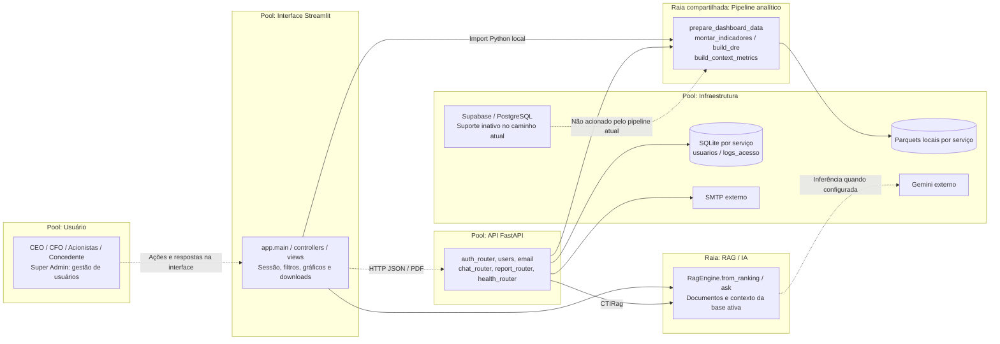
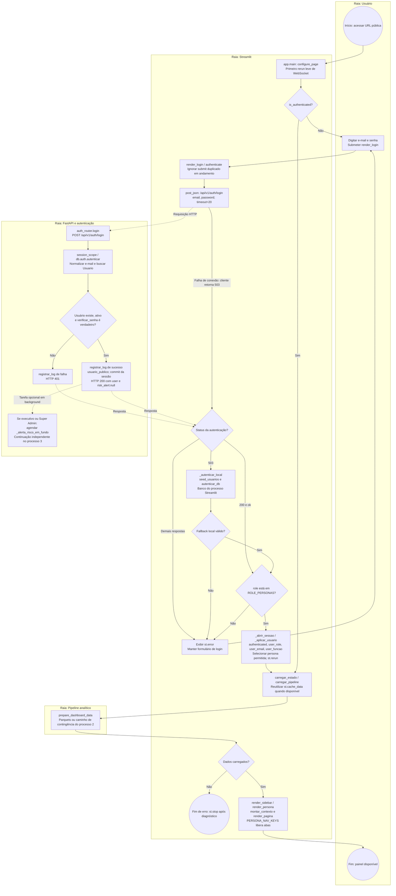
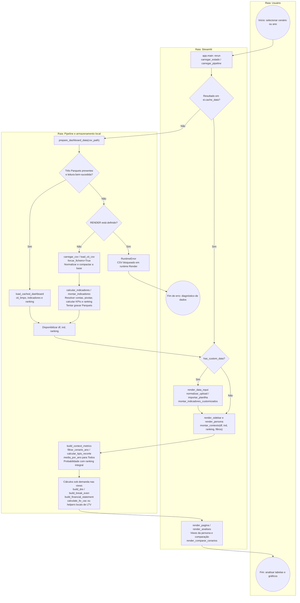
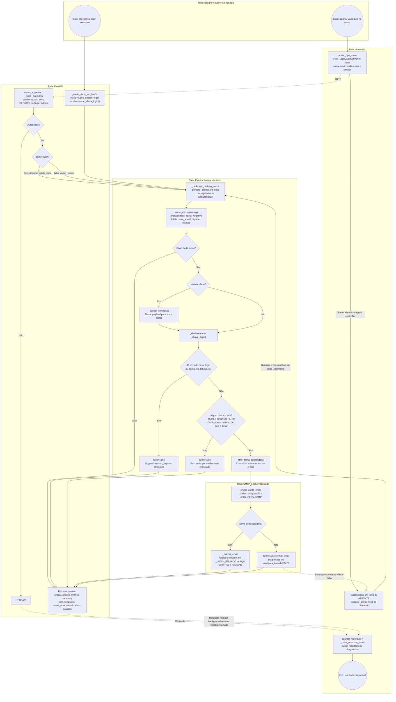
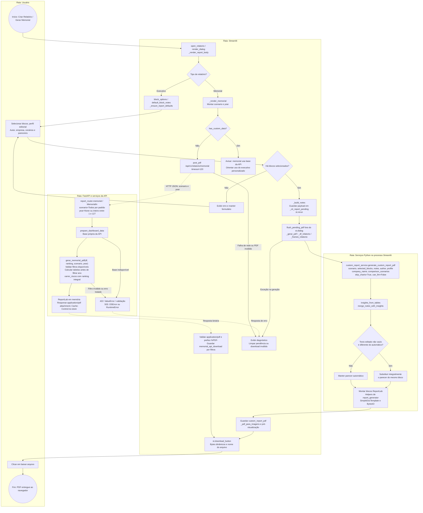
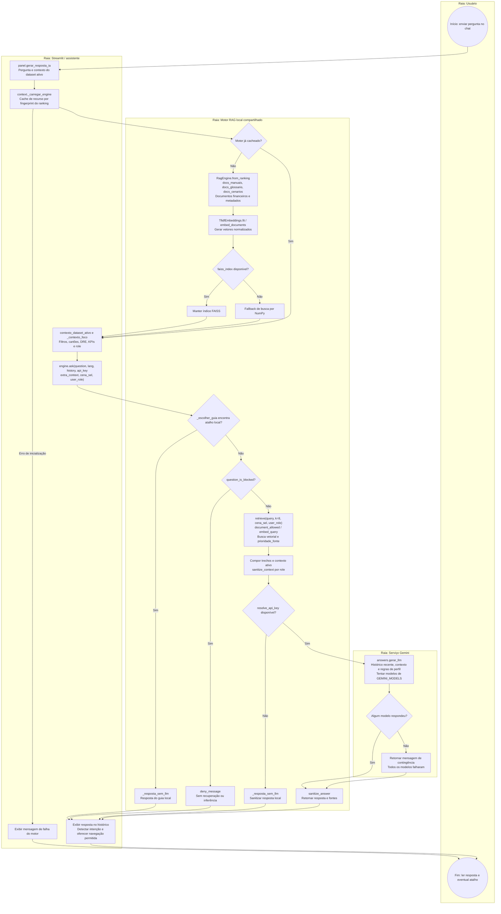

# Modelagem de Processos de Negócio — BPMN do Dashboard Financeiro CTI

Especificação derivada do código do repositório em 17/10/2026. Os processos descrevem o comportamento implementado em `PI4/Frontend` e `PI4/Backend`, incluindo caminhos alternativos, regras, dados e resultados observáveis.

## 1. Visão geral e mapeamento de raias — Pools & Lanes

### 1.1 Convenções

Os diagramas usam uma **representação visual de BPMN em Mermaid**, não XML BPMN executável. Subgraphs representam pools/raias; círculos representam eventos de início/fim; retângulos representam tarefas; losangos representam gateways exclusivos ou condições. Setas contínuas representam progressão do processo; setas tracejadas representam mensagens entre participantes ou associações explicitamente rotuladas. Uma transferência por import Python não implica comunicação HTTP. Os gateways possuem saídas identificadas; ramos opcionais de background são indicados no texto.

| Pool / raia | Responsabilidade e elementos reais |
|---|---|
| Usuário | CEO, CFO, Acionistas e Poder Concedente: autenticar, escolher filtros, analisar dados, editar pareceres e consultar IA. Super Admin é condição administrativa de uma conta, cujo seed usa função CEO. |
| Interface Streamlit | `app.py:main()`, controllers `auth`, `bootstrap`, `sidebar`, `navigation`, `data_input`, `ops_menu` e views; mantém `st.session_state`, exibe gráficos e oferece downloads. |
| Servidor FastAPI | `Backend/main.py`, `runtime.py` e routers de autenticação, usuários, e-mail, chat, saúde e memorial. Executa operações HTTP e tarefas em background. |
| Pipeline analítico | `dashboard_pipeline`, `dashboard_cache`, `metrics_calculator`, `scenario_filter`, leitores e `metrics/*`; opera DataFrames e Parquets. É importado tanto pelo Streamlit quanto pela API. |
| RAG / IA | `Frontend/src/models/rag_engine` e `views/ai_assistant`; TF-IDF, FAISS ou NumPy, documentos, contexto financeiro, regras por role e Gemini. API reutiliza esse motor via `Backend/rag_engine.py:CTIRag`. |
| Infraestrutura e persistência | Render em dois serviços, Parquets locais, SQLite de autenticação e servidor SMTP. Suporte SQL/Supabase existe, mas `USAR_SUPABASE=False`; não é uma fonte ativa ou fallback automático financeiro. |

### 1.2 Premissas verificadas e limites

- A leitura direta de `Backend/Cti.csv` encontrou **1.002.000 registros, 1.200 valores distintos de `CENA` e anos 1 a 12**. A quantidade pertence à base atual; os algoritmos trabalham com o universo recebido e não fixam 1.200 execuções.
- Não existe uma tarefa ativa que sorteie/execute novas trajetórias Monte Carlo. O processo 3 analisa as trajetórias armazenadas. `simular=True` testa alertas e não recalcula trajetórias.
- Cenários são selecionados por `CENA` / `cena_sel`. A expressão “cenários B3” não corresponde a uma integração com a B3 ou a um parâmetro de rota próprio; o processo 2 modela o seletor real do painel.
- EBITDA e EBIT são lidos de contas da DRE. A composição das tabelas ocorre sob demanda, com caches; não há obrigação de refazer todos os cálculos a cada clique.
- Executivo personalizado e memorial têm caminhos diferentes. O primeiro usa funções do Backend dentro do Streamlit; o segundo usa `POST /api/v1/relatorio/memorial`.

## 2. Processo 1 — Autenticação, RBAC e bootstrap de sessão

**Objetivo:** liberar uma sessão Streamlit conforme o perfil e carregar os dados necessários ao painel. **Início:** acesso à URL pública. **Entradas:** `LoginIn.email`, `LoginIn.password`. **Saídas:** sessão autenticada e `AppContext`, ou mensagem de rejeição/indisponibilidade.

### Regras e exceções

| Regra | Implementação |
|---|---|
| Validação de senha | `db/auth.py:verificar_senha()`, PBKDF2-HMAC-SHA256, salt e 120.000 iterações; comparação por `hmac.compare_digest` |
| CEO | Personas `ceo`, `cfo`, `acionistas`, `concedente` |
| CFO | Personas `cfo`, `acionistas`, `concedente` |
| Acionistas / Poder Concedente | Apenas `acionistas` / `concedente`, respectivamente |
| Super Admin | `navigation.render_analises()` acrescenta `admin_users` na persona CEO; API usa `_exigir_super_admin(email)` |
| Logs de acesso | `LogAcesso`: e-mail, função, sucesso, horário, IP e mensagem; consulta por `GET /api/v1/auth/logs?email=...&limite=200`, exigindo CEO ativo |
| Falha de API | `authenticate()` tenta `_autenticar_local()` em status 503; não faz fallback para credenciais rejeitadas com 401 |
| Falha no bootstrap | `carregar_estado()` tenta reler o cache em certas exceções; `MemoryError` retorna `None`; `app.main()` interrompe se estado ausente |

`db/database.py` usa `Backend/cache/cti_auth.db` no caminho ativo. Os SQLite do frontend e da API são independentes na implantação em dois serviços. O login não emite JWT; as rotas administrativas verificam o e-mail fornecido na query, sem ligação por token com a sessão Streamlit. Funções de cookie assinado existem, mas a sequência principal atual não as invoca para restaurar a sessão. Logout registra a saída por `POST /api/v1/auth/logout` e limpa o estado do painel preservando idioma.

## 3. Processo 2 — Exploração analítica, filtros de cenário e reconciliação DRE

**Objetivo:** apresentar o recorte financeiro e as comparações da base ativa. **Início:** seleção de `cena_sel` ou `ano_sel` ou abertura inicial do painel. **Entradas:** base longa `df`, indicadores `ind`, `ranking`, cenário, ano e persona. **Saída:** cartões, tabelas, séries, distribuição e gráficos atualizados.

### Regras financeiras e significado da reconciliação

1. `montar_indicadores()` mapeia nomes com `resolve_account_name()`, agrega por `ANO`, `ano_num`, `CENA` e campo e calcula NCG, prazos, liquidez, retorno e risco. Não é chamada para recalcular a base padrão a cada filtro quando o resultado está cacheado.
2. `build_dre(df, cena)` monta a tabela: receita líquida = receita + tributos; EBITDA = conta `DRE - EBITDA`; EBIT = conta `DRE - Resultado Operacional`. Lucro informado prevalece se `abs(lucro) > 1e-9`; senão usa EBIT + resultado financeiro + IR/CS. Isso não impõe uma reconciliação genérica entre EBITDA, depreciação e EBIT.
3. `build_break_even()` usa custos variáveis absolutos, custos fixos e margem de contribuição; divisores nulos podem produzir valores não definidos. `calculate_ltv_cac()` busca premissas por aliases e aplica padrões se ausentes. `views/persona_tabs/common.py` oferece `_dre`, `_break_even_df` e `_ltv_df` com caminhos cacheados da base padrão.
4. `_wide()` usa soma por ano/conta para cenário específico e média para `Todos`. `build_context_metrics()` mantém o risco de encerramento no universo integral do ranking, mesmo com filtro visual específico.
5. `cache_disponivel()` exige os três Parquets. O leitor isolado pode reconstruir uma base parcial por `df_longo_de_indicadores()` quando o bruto está vazio/ausente, mas a ausência do arquivo bruto bloqueia a entrada normal pelo teste dos três arquivos. Essa reconstrução não recupera todas as contas da DRE.
6. Nenhuma seleção consulta cotações da B3. A entrada de cenário real é a coluna `CENA`; o ano real é `ano_num`. Alterações de dados importados ficam na sessão e não atualizam automaticamente a base financeira da API.

**Preparação anterior ao processo:** `Backend/scripts/precompute_cache.py:main()` lê o CSV em chunks de 120.000 registros, normaliza contas e valores brasileiros, extrai `ano_num`, rejeita base vazia/com menos de 1.000 linhas, calcula indicadores/ranking e reescreve os três Parquets. O manifesto Render executa essa tarefa no build do frontend.

## 4. Processo 3 — Análise Monte Carlo, varredura e alertas de risco

**Objetivo:** avaliar risco das trajetórias existentes e emitir um único e-mail consolidado quando autorizado pelas regras. **Inícios:** login executivo com tarefa em background, ação manual no menu ou chamada do serviço. **Entradas HTTP:** query `email`; `VarreduraIn(enviar=True, simular=False)`. **Saída:** payload de varredura e resultado de envio.

O diagrama reúne variantes do mesmo serviço. O ramo de envio conhece a origem (`manual` ou `login`); a execução local reutiliza os mesmos gateways e retorna ao controller, sem novo POST. No fluxo de background, não há resposta de risco anexada ao login: o contrato mantém `risk_alert:null`; exceções são capturadas por `_alerta_risco_em_fundo()` e registradas em logs técnicos.

### Regras de risco e evidências de auditoria

| Item | Regra implementada |
|---|---|
| Universo | `CENA` distinta; base atual com 1.200 trajetórias de 12 anos, sem executar novas trajetórias |
| Encerramento | Maior `ano_num` da base; campo mantém o nome `caixa_ano12`; usa saldo final quando módulo > `1e-9`, senão disponível |
| Ruína | `100 × média(caixa_ano12 < 0)`; crítico acima de `RISK_RUIN_THRESHOLD`, padrão 15%; acima de 5% gera atenção se não ultrapassa o limiar crítico |
| P5 | Quantil 0,05 de `caixa_ano12`; crítico se negativo |
| Liquidez | Média do ranking abaixo de `RISK_LIQUIDEZ_MIN`, padrão 1,0; usa liquidez corrente, não liquidez geral do concedente |
| Selo | Participação de `Encerramento com Caixa Insuficiente` acima do limiar de ruína |
| Debounce | Padrão 900 s no login e 45 s no manual; estruturas em memória `_ULTIMO_DIGEST` e `_LOGIN_ENVIADO` |
| Consulta sem envio | `GET /api/v1/email/riscos?email=...` ou POST com `enviar=False`; este último não aplica simulação no ramo sem envio |
| Simulação de alerta | `simular=True` / `FORCE_EMAIL_ALERT_ON_LOGIN`; altera checks para teste, não a base de cenários |

**Distinção de logs:** login e logout persistem registros em `logs_acesso`. A varredura e o SMTP produzem logs técnicos/diagnósticos e payload de resultado; o fluxo não insere um registro `LogAcesso` para cada varredura ou envio. `risk_report.gerar_relatorio_riscos()` é utilitário adicional e não uma etapa obrigatória de cada alerta. `garantir_varredura_silenciosa()` apenas marca estado da sessão; não dispara varredura/e-mail automaticamente em cada renderização.

## 5. Processo 4 — Parecer executivo, PDF e memorial dinâmico

**Objetivo:** produzir um documento para download, respeitando a origem de dados de cada modalidade. **Início:** `Criar Relatório` no cabeçalho e seleção do tipo de relatório. **Modalidades:** executivo personalizado local e memorial técnico remoto.

### Contratos, regras e resultados

- **Executivo:** o payload em `st.session_state[PENDING_KEY]` contém `scenario`, `selected_blocks`, `notes`, `author`, `profile`, `company_name`, `comparison_scenarios` e `filename`. `_gerar_pdf()` importa o serviço do pacote Backend localmente; não envia esse payload por HTTP a `report_generator.py`.
- `generate_custom_report_pdf()` constrói seu próprio documento e reutiliza layout de `report_generator.py`; não é uma chamada obrigatória a `generate_executive_pdf()`. Usa tabelas preparadas `_dre`, `_break_even_df`, `_ltv_df` e até três cenários extras. A base customizada é aceita nesse caminho.
- `merge_notes_with_insights()` substitui integralmente o texto automático do bloco quando há texto diferente e não vazio. Campo vazio ou igual ao automático conserva a sugestão; não concatena pareceres indiscriminadamente.
- `profile` pode ser CEO, CFO ou CTO; é perfil editorial. CTO não é função autenticável. O executivo não recebe `year` para filtrar a base, mesmo com ano selecionado no painel.
- **Memorial:** `POST /api/v1/relatorio/memorial`, corpo `{"scenario":"Todos","year":null}` ou cenário/ano disponível. Os filtros também são validados contra a base pelo serviço. DRE, break-even, solvência e métricas comerciais são calculados para o cenário; o risco continua consolidado sobre todos os cenários. A geração não envia e-mail.
- Alterar filtros invalida o snapshot `memorial_api_download`. Em erro de geração executiva, `flush_pending_pdf()` remove a pendência e armazena diagnóstico para exibição. O fluxo normal usa bytes em memória e não exige salvar PDF no disco do servidor.
- Estes dois caminhos produzem PDF por ReportLab. A criação offline de DOCX em `PI4/scripts/gerar_memorial_cti.py` é outro processo, não uma etapa do download dinâmico.

## 6. Processo 5 — Consulta ao assistente financeiro IA / RAG

**Objetivo:** responder perguntas com o contexto permitido da base ativa e a documentação indexada. **Início:** envio de pergunta no chat do painel. **Entradas:** pergunta, histórico, idioma, cenário, ano, persona, role, DataFrames e KPIs. **Saída:** resposta textual na conversa e eventual atalho de navegação.

### Particularidades do motor e entrada alternativa HTTP

A indexação ocorre quando o recurso precisa ser construído, não a cada pergunta. `from_ranking()` inclui documentos detalhados por cenário apenas para ranking com até 80 linhas; bases maiores usam documentos resumidos. Ausência de arquivos documentais não elimina o contexto de KPIs do painel; o motor informa a limitação conforme o ramo de resposta. Falhas de montagem do contexto visual geram um contexto resumido de contingência.

O código verifica o guia local **antes** de `question_is_blocked()` em `ask()`; o diagrama preserva essa ordem. A recuperação filtra documentos por role e sanitiza contexto. Com chave ausente, a resposta é local. Com chave, `gerar_llm()` tenta os modelos configurados e usa mensagem de contingência se todos falharem. Não se deve representar toda resposta como obrigatoriamente gerada por Gemini.

A interface principal chama `RagEngine` por import local. Existe também a seguinte entrada independente:

| Etapa HTTP | Contrato real |
|---|---|
| Recepção | `POST /api/chat`, `ChatIn(message, session_id=None, user_role=None)` |
| Serviço | `chat_service.responder_chat(message, session_id, user_role)`; mensagem vazia retorna orientação sem carregar motor |
| Inicialização | `_rag()` cria `CTIRag` sob `Lock`; `CTIRag` reutiliza `RagEngine.from_ranking()` |
| Dados | `_carregar_ranking()` lê cache da API; sem cache na Render retorna ranking vazio; fora dela pode usar CSV e `montar_indicadores()` |
| Resposta | `ChatOut(response, sources)`; `_sessoes` guarda últimas 12 mensagens por sessão em memória |
| Limite | `user_role` vem do corpo, sem validação por token; esta entrada não recebe o dataset importado na sessão Streamlit |

## 7. Infraestrutura, contingências e relação entre os processos

| Condição | Resultado de negócio e implementação |
|---|---|
| Cache frontend pronto | Processo 1 libera a base; processo 2 reutiliza `st.cache_data` e os Parquets |
| Cache ausente fora da Render | Pipeline lê CSV, calcula indicadores e tenta gravar caches |
| Cache ausente na Render | Pipeline bloqueia CSV em runtime; painel mostra diagnóstico; memorial pode responder 503; alerta em background registra falha |
| Parquets presentes apenas no frontend | Não atendem à API: `render.yaml` executa precompute apenas no build do frontend, sem volume compartilhado declarado |
| Supabase desativado | Dados analíticos permanecem locais; autenticação usa SQLite. `db/database.init_db()` contém contingência PostgreSQL → SQLite, mas a flag atual já seleciona SQLite |
| SMTP indisponível | Resultado de envio contém diagnóstico; controller pode tentar execução local. Não existe garantia de entrega se a rede/configuração falhar nos dois processos |
| API indisponível | Login pode validar localmente; executivo e chat principal continuam com serviços locais quando os respectivos dados/dependências estão disponíveis; memorial depende da API |
| Serviço reiniciado | Históricos de chat e debounce em memória não constituem persistência durável; bancos e caches dos serviços não são sincronizados automaticamente |

A implantação principal está em `render.yaml`: `cti-frontend` executa Streamlit e precompute; `cti-api` executa Uvicorn. `start.sh` oferece uma execução alternativa conjunta, com FastAPI interna e Streamlit público. Os diagramas identificam o processo que executa cada tarefa, sem pressupor que a implantação foi realizada ou validada remotamente.

## 8. Rastreabilidade da especificação

| Processo / assunto | Fontes inspecionadas |
|---|---|
| Raias e execução | `PI4/Frontend/app.py`, `PI4/Backend/main.py`, `runtime.py`, `render.yaml`, `start.sh` |
| Processo 1 | `Frontend/src/controllers/auth.py`, `bootstrap.py`, `sidebar.py`, `navigation.py`; `Backend/routers/auth_router.py`, `users.py`; `Backend/db/auth.py`, `database.py`, `models.py` |
| Processo 2 | `Frontend/src/controllers/data_input.py`; `Backend/services/dashboard_pipeline.py`, `dashboard_cache.py`, `metrics_calculator.py`, `scenario_filter.py`; `Backend/data_loader/*`; `Backend/metrics/financial_kpis.py`, `commercial_kpis.py`; `Frontend/src/views/persona_tabs/common.py` |
| Processo 3 | `Frontend/src/controllers/ops_menu.py`; `Backend/routers/email.py`, `auth_router.py`; `Backend/services/risk_alerts.py`, `email_service.py`, `risk_report.py` |
| Processo 4 | `Frontend/src/views/report.py`, `controllers/modals.py`; `Backend/routers/report_router.py`; `Backend/services/custom_report_service.py`, `report_insights.py`, `report_generator.py`, `memorial_report.py` |
| Processo 5 | `Frontend/src/views/ai_assistant/panel.py`, `context.py`; `Frontend/src/models/rag_engine/engine.py`, `embeddings.py`, `documents.py`, `rbac.py`, `answers.py`; `Backend/rag_engine.py`, `routers/chat_router.py`, `services/chat_service.py` |
| Base e preparação | `Backend/Cti.csv`, `Backend/scripts/precompute_cache.py`, `PI4/scripts/precompute_cache.py` |

A especificação foi construída por inspeção estática e conferência da volumetria do CSV. Não implica execução de SMTP, Gemini, implantação Render ou nova simulação. O documento mantém explícitas as diferenças entre a descrição de negócio solicitada e os mecanismos presentes no código.
