# BPMN único — Processo integrado do Dashboard Financeiro CTI

Um único processo reúne autenticação, análise financeira, risco, relatórios e assistente. Raias representam participantes e responsabilidades; círculos são eventos, retângulos são tarefas e losangos são decisões. Setas tracejadas indicam mensagens ou associações identificadas. Esta é uma representação de BPMN em Mermaid, não um modelo BPMN XML executável.

```mermaid
flowchart TD
    subgraph USUARIO["Raia: Usuário — CEO / CFO / Acionistas / Concedente"]
        INICIO(("Início: acessar URL pública"))
        CRED["Informar e-mail e senha"]
        ACAO{"Escolher ação no painel"}
        FILTRO["Selecionar cenário, ano ou base importada"]
        PEDIRRISCO["Consultar risco ou solicitar alerta\nCEO / CFO / Super Admin"]
        PEDIRPDF["Criar relatório / gerar memorial"]
        PERGUNTA["Enviar pergunta no chat"]
        CONTINUAR{"Continuar usando o painel?"}
        FIM(("Fim: sessão encerrada"))
    end

    subgraph STREAMLIT["Raia: Interface Streamlit — app.py, controllers e views"]
        ABRIR["main / configure_page\nInicializar interface e sessão"]
        JA{"is_authenticated?"}
        LOGIN["render_login / authenticate\npost_json: email, password"]
        STATUS{"Resultado do login?"}
        LOCAL["_autenticar_local\nValidar no banco do Streamlit"]
        LOCALOK{"Credenciais locais válidas?"}
        ERROLOGIN["Exibir erro e permitir nova tentativa"]
        SESSAO["_abrir_sessao / _aplicar_usuario\nAplicar ROLE_PERSONAS e st.rerun"]
        BOOT["carregar_estado / carregar_pipeline\nReutilizar st.cache_data"]
        TEMDADOS{"Dados disponíveis?"}
        SEMDADOS(("Fim de erro: diagnóstico de carga"))
        PAINEL["render_sidebar / render_persona\nmontar_contexto / render_pagina\nLiberar abas conforme perfil"]
        ENTRADA["render_data_input\nImportar CSV/XLSX ou editar base"]
        GRAFICOS["Renderizar KPIs, DRE, séries\nDistribuição, risco e comparação"]
        OPS["render_ops_menu\nEnviar query email e body enviar/simular"]
        RISCOUI["guardar_varredura\nExibir resultado / diagnóstico"]
        FALLRISCO["Falha de API/SMTP no acionamento manual:\ntentar disparar_alerta_risco localmente"]
        TIPO{"Tipo de relatório?"}
        EDITAR["Editar blocos, pareceres e perfil editorial\nGuardar _cti_report_pending; st.rerun"]
        FLUSH["flush_pending_pdf fora do dialog\n_gerar_pdf com base ativa"]
        CUSTOM{"Base customizada ativa?"}
        BLOQUEAR["Memorial usa base CTI da API\nOrientar executivo personalizado"]
        MEMREQ["post_pdf: scenario, year\ntimeout=120"]
        DOWNLOAD["Prévia quando disponível\nst.download_button com bytes PDF"]
        ERROPDF["Exibir falha de geração ou da API"]
        CHAT["gerar_resposta_ia\nContexto da base ativa, filtros e role"]
        RESPOSTA["Exibir resposta e eventual\natalho de navegação permitido"]
        SAIR["logout\nRegistrar saída pela API\nLimpar session_state preservando idioma"]
    end

    subgraph FASTAPI["Raia: Servidor FastAPI — routers e autenticação"]
        AUTHAPI["POST /api/v1/auth/login\nlogin / autenticar\nBuscar Usuario ativo e verificar_senha"]
        VALIDO{"E-mail, senha e usuário válidos?"}
        REJEITAR["registrar_log de falha\nHTTP 401"]
        ACEITAR["registrar_log de sucesso\nusuario_publico; HTTP 200\nSessão não usa JWT"]
        EXECUTIVO{"CEO / CFO ou Super Admin?"}
        BACKGROUND["BackgroundTasks\n_alerta_risco_em_fundo\nLogin já pode prosseguir"]
        RISCOAPI["GET /api/v1/email/riscos ou\nPOST /api/v1/email/varrer-risco\n_exigir_executivo pelo email recebido"]
        AUTORIZADO{"Solicitante autorizado?"}
        NEGAR["HTTP 403"]
        MEMAPI["POST /api/v1/relatorio/memorial\nMemorialIn: scenario e year"]
        MEMGERAR["gerar_memorial_pdf\nValidar cenário/ano; calcular demonstrativos\nFiltrar ano após cálculos\nRisco do ranking integral, sem SMTP"]
        LOGOUTAPI["POST /api/v1/auth/logout\nregistrar_log de saída"]
    end

    subgraph ANALITICO["Raia: Pipeline analítico e serviços Python compartilhados"]
        DADOS["prepare_dashboard_data\nLeitura no processo chamador"]
        CACHEOK{"Três Parquets presentes\ne legíveis?"}
        PARQUET["load_cached_dashboard\ndf, ind, ranking"]
        RENDER{"RENDER definido?"}
        CARGAERRO["RuntimeError\nCSV bloqueado em runtime Render"]
        CSV["carregar_csv / load_cti_csv\nNormalizar contas e valores"]
        IND["montar_indicadores\nCalcular KPIs, ranking e selos\nTentar salvar Parquets"]
        BASECUSTOM{"Dados importados ou editados?"}
        NORMALIZAR["normalizar_upload / importar_planilha\nmontar_indicadores_customizados"]
        RECORTE["build_context_metrics\nfiltrar_cenario_ano / calcular_kpis_recorte\nProbabilidade sobre ranking integral"]
        DRE["build_dre / build_break_even\nbuild_financial_statement / calculate_ltv_cac\nReutilizar resultados cacheados quando possível"]
        VARREDURA["varrer_riscos\nLer ranking das trajetórias existentes\nCalcular ruína, P5, liquidez e selos"]
        ENVIO{"Fluxo solicita envio?"}
        TESTE["Se simular=True:\n_aplicar_simulacao para teste de alerta\nNão gera novas trajetórias"]
        DEBOUNCE{"Já enviado no login\nou dentro do debounce?"}
        CRITICO{"Algum check crítico?\nRuína > 15% ou P5 < 0\nou liquidez < 1 ou selo > 15%\nLimiares padrão configuráveis"}
        SEMENVIO["Retornar varredura sem envio\nInformar skipped quando aplicável"]
        EMAIL["disparar_alerta_risco\nhtml_alerta_consolidado\nenviar_alerta_email"]
        NOTAS["generate_custom_report_pdf\ninsights_from_tables\nmerge_notes_with_insights"]
        TEXTO{"Parecer editado não vazio\ne diferente do automático?"}
        SUBSTITUIR["Substituir integralmente\no texto do mesmo bloco"]
        MANTER["Manter parecer automático"]
        PDF["Montar PDF ReportLab em memória\nHelpers de report_generator\nskip_charts=True; use_llm=False"]
        MEMBASE["prepare_dashboard_data na API\nUsar cache próprio deste serviço"]
    end

    subgraph RAG["Raia: Serviço RAG / IA — execução principal local no Streamlit"]
        MOTOR["_carregar_engine por fingerprint do ranking\nReutilizar recurso ou construir RagEngine"]
        INDEX["Na construção: docs_manuais, docs_glossario\ne docs_cenarios; TfidfEmbeddings\nFAISS ou fallback NumPy"]
        GUIA{"Pergunta tem guia local?"}
        GUIARES["Responder pelo guia local"]
        BLOQUEADA{"question_is_blocked?"}
        RECUSAR["deny_message conforme role"]
        BUSCA["retrieve: embed_query e busca vetorial\ndocument_allowed / sanitize_context\nIncluir contexto financeiro ativo"]
        CHAVE{"Chave de IA disponível?"}
        RESLOCAL["_resposta_sem_llm\nResposta local de contingência"]
        LLM["gerar_llm\nTentar modelos GEMINI_MODELS\nContingência se todos falharem\nsanitize_answer"]
    end

    subgraph INFRA["Raia: Infraestrutura — Render, armazenamento e SMTP"]
        BUILD["Build do frontend\nBackend/scripts/precompute_cache.py\nCti.csv: 1.200 cenários, anos 1 a 12\nGerar três Parquets"]
        ARQUIVOS[("Parquets locais por serviço\ncti_limpo / indicadores / ranking\nSem compartilhamento automático")]
        SQLITE[("SQLite por serviço: cti_auth.db\nUsuario e LogAcesso\nSupabase desativado no código atual")]
        SMTP["Servidor SMTP\nConfiguração e rede necessárias"]
        SUCESSO{"Envio SMTP bem-sucedido?"}
        ENVIADO["sent=True; recipients\nAtualizar debounce em memória"]
        FALHAEMAIL["sent=False; email_error\nLogs técnicos e diagnóstico"]
        GEMINI["Google Gemini"]
    end

    INICIO --> ABRIR --> JA
    JA -->|Não| CRED --> LOGIN
    LOGIN -. "HTTP" .-> AUTHAPI
    AUTHAPI --> VALIDO
    AUTHAPI --- SQLITE
    VALIDO -->|Não| REJEITAR
    VALIDO -->|Sim| ACEITAR
    REJEITAR -. "Resposta" .-> STATUS
    ACEITAR -. "Resposta" .-> STATUS
    LOGIN -->|"Falha de rede: status 503"| STATUS
    STATUS -->|"200 e ok"| SESSAO
    STATUS -->|503| LOCAL --> LOCALOK
    LOCAL --- SQLITE
    LOCALOK -->|Sim| SESSAO
    LOCALOK -->|Não| ERROLOGIN
    STATUS -->|"Demais respostas"| ERROLOGIN
    ERROLOGIN --> CRED
    ACEITAR -. "Ramo opcional independente" .-> EXECUTIVO
    EXECUTIVO -->|Sim| BACKGROUND --> VARREDURA
    EXECUTIVO -->|Não| SEMALERTA(("Fim do ramo: sem alerta de login"))
    JA -->|Sim| BOOT
    SESSAO --> BOOT --> DADOS --> CACHEOK
    BUILD -. "Preparação anterior ao runtime" .-> ARQUIVOS
    DADOS --- ARQUIVOS
    CACHEOK -->|Sim| PARQUET --> TEMDADOS
    CACHEOK -->|Não| RENDER
    RENDER -->|Sim| CARGAERRO --> TEMDADOS
    RENDER -->|Não| CSV --> IND --> TEMDADOS
    TEMDADOS -->|Não| SEMDADOS
    TEMDADOS -->|Sim| PAINEL --> ACAO

    ACAO -->|Analisar| FILTRO --> ENTRADA --> BASECUSTOM
    BASECUSTOM -->|Sim| NORMALIZAR --> RECORTE
    BASECUSTOM -->|Não| RECORTE
    RECORTE --> DRE --> GRAFICOS --> CONTINUAR

    ACAO -->|Risco| PEDIRRISCO --> OPS
    OPS -. "HTTP" .-> RISCOAPI --> AUTORIZADO
    AUTORIZADO -->|Não| NEGAR -. "Resposta" .-> RISCOUI
    AUTORIZADO -->|Sim| VARREDURA
    VARREDURA --> ENVIO
    ENVIO -->|"Consulta ou enviar=False"| SEMENVIO
    ENVIO -->|"Alerta manual ou de login"| TESTE --> DEBOUNCE
    DEBOUNCE -->|Sim| SEMENVIO
    DEBOUNCE -->|Não| CRITICO
    CRITICO -->|Não| SEMENVIO
    CRITICO -->|Sim| EMAIL -. "SMTP" .-> SMTP --> SUCESSO
    SUCESSO -->|Sim| ENVIADO
    SUCESSO -->|Não| FALHAEMAIL
    SEMENVIO --> RESULTADORISCO{"Origem da execução?"}
    ENVIADO --> RESULTADORISCO
    FALHAEMAIL --> RESULTADORISCO
    RESULTADORISCO -->|"Background do login"| FIMBG(("Fim do ramo: resultado ou falha em log técnico"))
    RESULTADORISCO -->|Manual| RISCOUI
    OPS -->|"Falha de API/SMTP detectada"| FALLRISCO
    FALLRISCO -->|"Mesmo fluxo executado localmente"| VARREDURA
    RISCOUI --> CONTINUAR

    ACAO -->|Documento| PEDIRPDF --> TIPO
    TIPO -->|Executivo| EDITAR --> FLUSH --> NOTAS --> TEXTO
    TEXTO -->|Sim| SUBSTITUIR --> PDF
    TEXTO -->|Não| MANTER --> PDF
    PDF --> DOWNLOAD
    FLUSH -->|"Exceção na geração"| ERROPDF
    TIPO -->|Memorial| CUSTOM
    CUSTOM -->|Sim| BLOQUEAR --> CONTINUAR
    CUSTOM -->|Não| MEMREQ -. "HTTP JSON" .-> MEMAPI
    MEMAPI --> MEMBASE --> MEMGERAR
    MEMBASE -->|"Cache indisponível: 503"| ERROPDF
    MEMGERAR -->|"PDF application/pdf"| DOWNLOAD
    MEMGERAR -->|"Filtro inválido: 422"| ERROPDF
    MEMREQ -->|"Falha de rede ou PDF inválido"| ERROPDF
    ERROPDF --> CONTINUAR
    DOWNLOAD --> CONTINUAR

    ACAO -->|Assistente| PERGUNTA --> CHAT --> MOTOR --> INDEX --> GUIA
    GUIA -->|Sim| GUIARES --> RESPOSTA
    GUIA -->|Não| BLOQUEADA
    BLOQUEADA -->|Sim| RECUSAR --> RESPOSTA
    BLOQUEADA -->|Não| BUSCA --> CHAVE
    CHAVE -->|Não| RESLOCAL --> RESPOSTA
    CHAVE -->|Sim| LLM
    LLM -. "Inferência externa" .-> GEMINI
    GEMINI -. "Resposta ou falha" .-> LLM
    LLM --> RESPOSTA --> CONTINUAR

    CONTINUAR -->|Sim| ACAO
    CONTINUAR -->|Não| SAIR
    ACAO -->|Sair| SAIR
    SAIR -. "HTTP" .-> LOGOUTAPI
    LOGOUTAPI --- SQLITE
    SAIR --> FIM
```

O fluxo analisa trajetórias já existentes, sem executar uma nova simulação Monte Carlo. EBITDA e EBIT vêm das contas informadas na DRE. A indexação do RAG ocorre na construção do motor; consultas posteriores reutilizam o recurso. O chat principal e o executivo personalizado usam serviços locais no processo Streamlit; o memorial depende da API. `/api/chat` é uma entrada HTTP alternativa ao assistente, não a etapa usada pelo chat principal representado aqui.

Os ramos de risco em background não bloqueiam a abertura do painel. Logs de acesso são persistidos no SQLite; diagnósticos de risco/SMTP são logs técnicos, sem um registro de auditoria de acesso para cada envio. O diagrama resume exceções: os detalhes e contratos completos estão em [BPMN_PROCESSES.md](BPMN_PROCESSES.md).
