# Dashboard Financeiro CTI — Guia simples e visual

O dashboard transforma dados financeiros em cartões, tabelas e gráficos para ajudar a entender **resultado, caixa, investimentos e risco**. Cada perfil vê as informações mais úteis para sua função.

## Sumário — encontre o que precisa

| Número | Tópico |
|---|---|
| **1** | [Como tudo funciona](#topico-1) |
| **2** | [Entrar e escolher uma visão](#topico-2) |
| **2.1** | [Cadastrar um novo usuário pelo e-mail](#topico-2-1) |
| **3** | [Escolher os dados e os filtros](#topico-3) |
| **3.1** | [Inserir novos dados: passo a passo](#topico-3-1) |
| **4** | [Ler as informações na tela](#topico-4) |
| **4.1** | [Comparar cenários](#topico-4-1) |
| **4.2** | [Criar novos gráficos e análises](#topico-4-2) |
| **5** | [Entender o risco](#topico-5) |
| **5.1** | [Quando pode haver um alerta por e-mail?](#topico-5-1) |
| **6** | [Perguntar ao assistente de IA](#topico-6) |
| **7** | [Criar e baixar um relatório](#topico-7) |
| **7.1** | [Enviar um relatório por e-mail](#topico-7-1) |
| **7.1.1** | [Testar o envio](#topico-7-1-1) |
| **7.1.2** | [Enviar a avaliação de risco](#topico-7-1-2) |
| **8** | [O que acontece por trás da tela?](#topico-8) |
| **9** | [Um roteiro prático para começar](#topico-9) |

## 1. Como tudo funciona

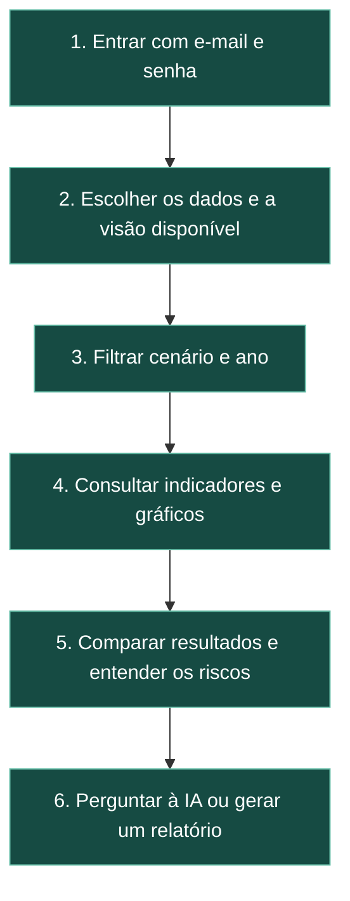

## 2. Entrar e escolher uma visão

Você informa seu **e-mail e sua senha**. Depois da validação, o sistema libera as visões permitidas para sua conta.

| Perfil | O que acompanha | Visões que pode abrir |
|---|---|---|
| **CEO** | Resultado da operação, DRE, equilíbrio financeiro e métricas comerciais | CEO, CFO, Acionistas e Poder Concedente |
| **CFO** | Capital de giro, tesouraria, prazos e risco | CFO, Acionistas e Poder Concedente |
| **Acionistas** | Retorno do investimento, geração de valor e dividendos | Acionistas |
| **Poder Concedente** | Investimentos, capacidade de pagamento e ativos | Poder Concedente |

O **Super Admin** também pode criar e listar usuários. Na configuração inicial do projeto, sua conta tem função CEO. A visão CEO oferece consulta dos registros de acesso.

### 2.1. Cadastrar um novo usuário pelo e-mail

Essa tarefa é exclusiva do **Super Admin**.

1. Entre com a conta Super Admin e abra a visão **CEO**.
2. Acesse a aba de administração de usuários.
3. Preencha **“E-mail do novo usuário”** com um endereço existente, como `analista@empresa.com`.
4. Informe uma **“Senha temporária”**.
5. Em **“Atribuir Cargo/Perfil”**, escolha CEO, CFO, Acionistas ou Poder Concedente.
6. Clique em **“Cadastrar Usuário”** e confira a confirmação e a listagem de usuários.

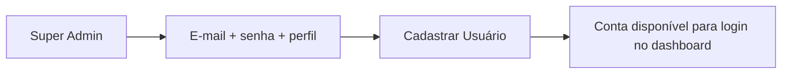

O cadastro cria **acesso ao dashboard associado ao e-mail**. Ele não cria uma caixa de correio, como uma nova conta Gmail ou Outlook, nem envia convite ou senha automaticamente por e-mail. Se o endereço já estiver cadastrado, o sistema informa o conflito. O formulário atual oferece criação e listagem; não há edição de senha ou exclusão de usuário nessa tela.

## 3. Escolher os dados e os filtros

A base padrão contém os dados financeiros do projeto. Você também pode importar um arquivo **CSV ou Excel (`.xlsx`)** ou editar dados pela interface.

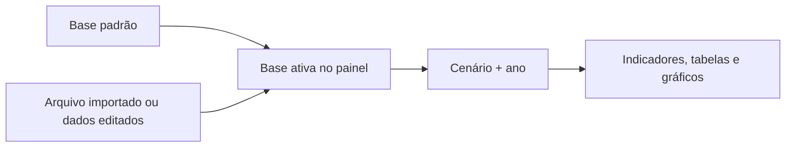

| Controle | Para que serve | Exemplo de uso |
|---|---|---|
| **Base de dados** | Escolher quais dados analisar | Usar a base original ou uma planilha importada |
| **Cenário** | Escolher uma trajetória financeira da base | Examinar um cenário específico |
| **Ano** | Escolher o período da análise | Observar o Ano 3 |
| **Visão / persona** | Organizar as análises por responsabilidade | Trocar da visão CEO para CFO, se permitido |

**Ao selecionar “Todos” os cenários**, os demonstrativos apresentam médias por ano e conta. Os cenários representam alternativas do mesmo projeto; somá-los como se fossem empresas diferentes distorceria a leitura.

Os dados importados ficam na sessão do painel. Eles não substituem automaticamente a base usada pela API para memorial e alertas. A interface permite restaurar a base original.

### 3.1. Inserir novos dados: passo a passo

Na barra lateral, abra **“Inserção de Dados”**. Dentro dela está o **“Gerenciador de Bases de Dados”**.

1. Confira **“Selecione a Base Ativa”** para saber qual conjunto está em uso.
2. Se precisar de um exemplo, abra **“Ver exemplo de estrutura válida”** e baixe o modelo CSV ou Excel.
3. Envie o arquivo em **“Arquivo de novos dados”** ou preencha linhas no editor manual.
4. Se for criar uma base separada, preencha **“Nome da nova base”**.
5. Escolha o **“Modo de aplicação”** conforme a tabela abaixo.
6. Clique em **“Aplicar/Salvar Novos Dados”**. Confira a mensagem de sucesso ou os erros de formato.
7. Verifique a base ativa e a **“Pré-visualização da tabela ativa”**. Depois escolha os filtros e consulte as análises.

| Modo | O que acontece |
|---|---|
| **Salvar como Nova Base** | Cria um conjunto separado e o seleciona como base ativa |
| **Concatenar à Base Selecionada** | Acrescenta as novas linhas ao conjunto que está selecionado |

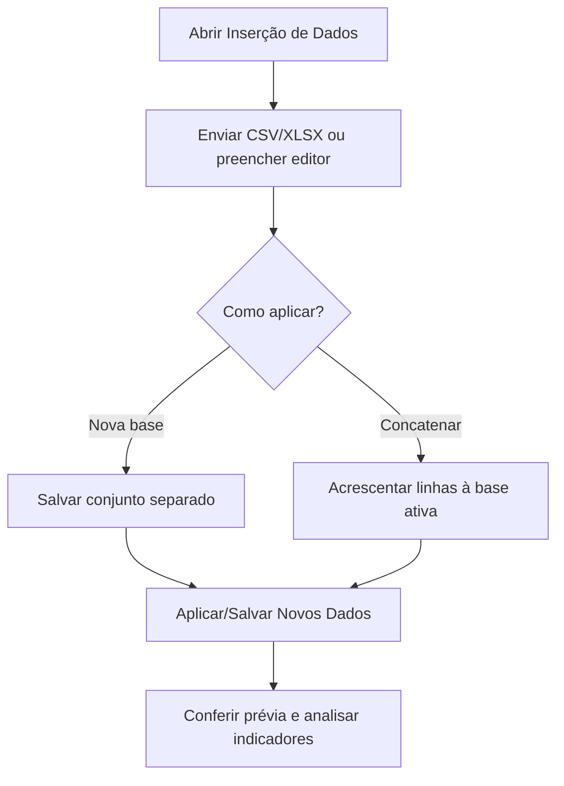

**Formato simples de exemplo:** cada linha pode representar uma conta de um cenário em um ano.

| ANO | CENA | CONTA | VALOR |
|---|---|---|---|
| Ano 1 | Cenario_Exemplo | DRE - Receita | 1000000 |
| Ano 1 | Cenario_Exemplo | DRE - EBITDA | 250000 |
| Ano 2 | Cenario_Exemplo | DRE - Receita | 1100000 |

Este exemplo ensina a estrutura; três linhas não fornecem todas as contas necessárias para uma análise financeira completa. O sistema também aceita o modelo largo, com cenário, ano e indicadores em colunas. Use o modelo disponibilizado na tela para conferir os nomes aceitos.

Ao concatenar, as linhas são **acrescentadas**, não substituídas por chave. Reenviar a mesma informação pode duplicar valores nas agregações. Se houver arquivo enviado e linhas válidas no editor, ambos podem entrar na aplicação dos dados.

Para voltar à base padrão, clique em **“Restaurar Dados Originais”**. Para remover uma base adicionada, escolha-a em **“Excluir base adicionada”** e use **“Excluir Base Selecionada”**. Essas bases ficam na sessão do painel; não são um cadastro permanente no servidor.

## 4. Ler as informações na tela

Comece pelos **cartões de indicadores**, acompanhe a evolução nos **gráficos** e consulte as **tabelas** para entender os valores em detalhe.

| Informação | Pergunta que ajuda a responder |
|---|---|
| **DRE** | Como receitas, custos e resultados se organizam? |
| **EBITDA e EBIT** | Quais resultados operacionais estão informados na base? |
| **Break-even** | Qual receita de equilíbrio o modelo calcula? |
| **NCG — necessidade de capital de giro** | Quanto recurso a operação exige para funcionar? |
| **Saldo de tesouraria** | Como o disponível se compara aos empréstimos de curto prazo? |
| **Prazos e ciclo financeiro** | Como os prazos de receber, manter estoques e pagar se relacionam? |
| **Liquidez** | Como os ativos se comparam às obrigações consideradas pelo indicador? |
| **ROIC, ROE e EVA** | Como o projeto remunera o capital e gera valor? |
| **CAPEX** | Qual o volume de investimentos? |
| **Dividendos** | Qual distribuição o modelo calcula com sua política de payout? |
| **LTV/CAC** | Como o valor estimado do cliente se compara ao custo de aquisição? |

EBITDA e EBIT são lidos das contas financeiras informadas. Alguns indicadores usam premissas padrão quando faltam dados específicos. Dividendos calculados representam uma política do modelo, não uma confirmação de pagamento realizado.

### 4.1. Comparar cenários

A comparação coloca cenários lado a lado para observar diferenças de resultado, caixa, retorno ou solvência, conforme a visão selecionada.

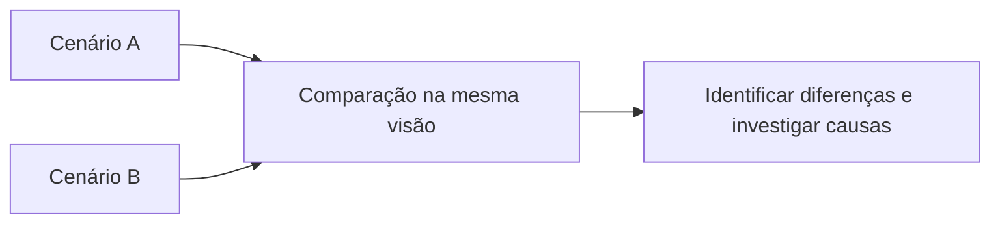

### 4.2. Criar novos gráficos e análises

Você pode acrescentar uma análise na visão que está usando, a partir dos indicadores já disponíveis no sistema.

1. Abra a visão desejada, como CEO ou CFO.
2. Clique no botão **“+”** ao lado da navegação das análises.
3. Na janela **“Adicionar análise customizada”**, escolha o **“Indicador financeiro”**.
4. Escolha o **“Tipo de gráfico”**.
5. Clique em **“Adicionar ao Dashboard”**. Uma nova aba de análise será criada para essa persona.

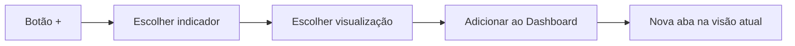

| Tipo disponível | Quando ajuda |
|---|---|
| **Linha** | Acompanhar a evolução do indicador ao longo dos anos |
| **Barra** | Comparar os valores anuais |
| **Área** | Visualizar a evolução com preenchimento sob a curva |
| **Card KPI** | Destacar um valor do recorte selecionado |
| **Tabela** | Consultar os valores da série |

**Exemplo:** escolha um indicador de receita disponível no catálogo e o tipo **Linha** para observar sua evolução no cenário selecionado.

Os gráficos de linha, barra e área e a tabela mostram a série anual do cenário. O filtro de ano afeta o card e o valor indicado como **“Valor do recorte atual”**; não corta a série desses gráficos. As análises ficam guardadas na sessão, separadas por persona. O formulário usa métricas do catálogo: não permite digitar uma nova fórmula livre nem transforma automaticamente qualquer coluna importada em um novo indicador.

## 5. Entender o risco

O painel analisa várias trajetórias possíveis do projeto. Na base padrão inspecionada, existem **1.200 cenários ao longo de 12 anos**.

**Essas trajetórias já estão nos dados.** O dashboard calcula indicadores sobre elas; não executa uma nova simulação Monte Carlo a cada seleção de filtro.

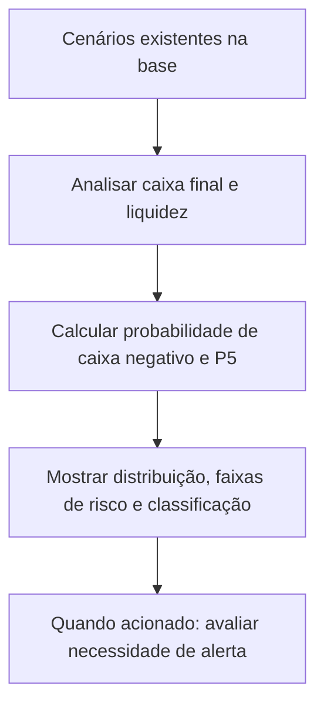

| Medida | Significado simples |
|---|---|
| **Probabilidade de caixa negativo** | Percentual dos cenários que encerram com caixa abaixo de zero |
| **P5 do caixa** | Valor abaixo do qual ficam aproximadamente 5% dos resultados de caixa; ajuda a observar a cauda pessimista |
| **Faixa de risco** | Intervalo de resultados entre cenários, para visualizar a dispersão ao longo dos anos |
| **Selos de classificação** | Grupos de cenários conforme regras de caixa, liquidez, retorno, investimentos e distribuição |

O risco consolidado considera o conjunto de cenários, mesmo quando você seleciona um cenário específico para consultar sua DRE.

### 5.1. Quando pode haver um alerta por e-mail?

CEO, CFO e Super Admin podem acionar a varredura pelo menu de operações. O login desses usuários também pode iniciar uma avaliação em segundo plano.

Os padrões do projeto consideram críticos, entre outros critérios:

- Probabilidade de caixa negativo **acima de 15%**.
- **P5 do caixa abaixo de zero**.
- Liquidez média **abaixo de 1,0**.
- Concentração elevada do selo de encerramento com caixa insuficiente.

Os limites são configuráveis. O envio depende das condições de risco, do controle de repetição, da configuração SMTP e da rede. O botão de simular alerta testa esse fluxo; ele não cria novos cenários financeiros.

## 6. Perguntar ao assistente de IA

O chat combina informações do painel com documentos do projeto para ajudar a explicar indicadores e resultados.

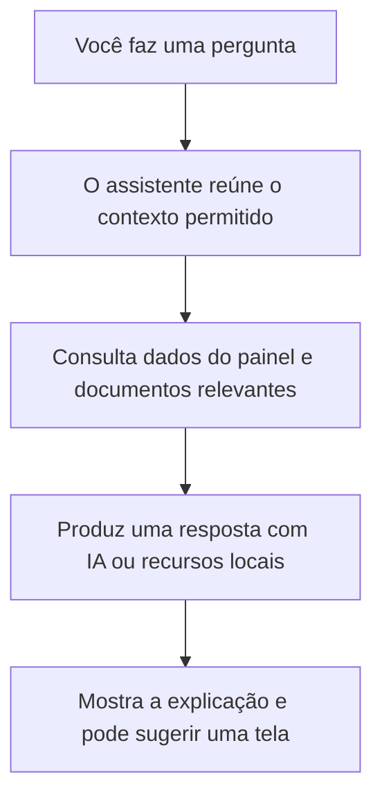

Exemplos de perguntas:

- “O que significa a NCG deste cenário?”
- “Como interpretar o ROIC?”
- “Onde encontro o gráfico de CAPEX?”
- “O que o P5 do caixa indica?”

O assistente recebe o contexto da base ativa e dos filtros, respeitando as regras de perfil implementadas. Quando a IA externa não está disponível, há respostas locais de contingência. A explicação ajuda na leitura dos resultados; confira os valores também nos cartões e tabelas.

## 7. Criar e baixar um relatório

Ao clicar em **“Criar Relatório”**, você escolhe entre dois tipos de documento.

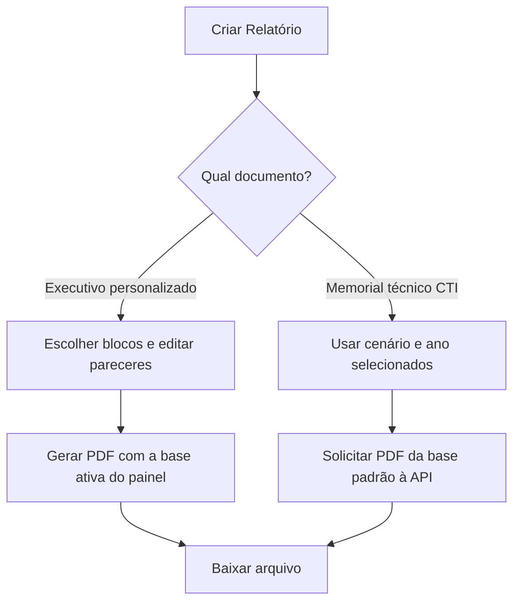

| | Executivo personalizado | Memorial técnico CTI |
|---|---|---|
| **Objetivo** | Apresentar análises e pareceres selecionados | Explicar cálculos, indicadores e risco |
| **Dados** | Base ativa do painel, inclusive importada | Base CTI disponível no servidor da API |
| **Texto** | Permite editar os pareceres dos blocos | Texto técnico gerado a partir dos cálculos |
| **Filtros** | Usa o cenário; o ano do painel não é aplicado como recorte desse gerador | Recebe cenário e ano explicitamente |
| **Geração** | No processo do dashboard | Pela API |
| **Entrega** | PDF para download, com prévia quando disponível | PDF para download |

Um parecer editado substitui o texto automático do mesmo bloco. No memorial, os demonstrativos seguem os filtros, mas a seção de risco permanece consolidada sobre o universo de cenários.

**Se você estiver usando dados importados**, escolha o executivo personalizado. A interface bloqueia o memorial nesse caso para evitar que você confunda os dados do painel com os dados da API.

### 7.1. Enviar um relatório por e-mail

O envio implementado no dashboard é um **relatório executivo de risco no corpo do e-mail**, com resumo e indicadores. Os PDFs do executivo personalizado e do memorial são oferecidos para **download**; o painel atual não possui um botão para anexar esses PDFs a um e-mail.

#### 7.1.1. Testar o envio

Para CEO, CFO e Super Admin:

1. Abra o menu **“⋮”** no cabeçalho.
2. Preencha **“E-mail de destino do teste”**.
3. Clique em **“Disparar E-mail de Teste”**.
4. Confira a mensagem de sucesso ou o diagnóstico de configuração/rede.

Esse campo escolhe o destinatário **do teste**; ele não altera o destino da varredura de risco.

#### 7.1.2. Enviar a avaliação de risco

1. No mesmo menu **“⋮”**, clique em **“Varrer Riscos do Modelo Financeiro”**.
2. O sistema avalia os cenários da base usada pelo serviço de risco.
3. Se detectar uma condição crítica e o controle de repetição permitir, tenta enviar um único e-mail consolidado.
4. Confira a mensagem de resultado: sem risco crítico, a varredura pode concluir sem enviar mensagem.

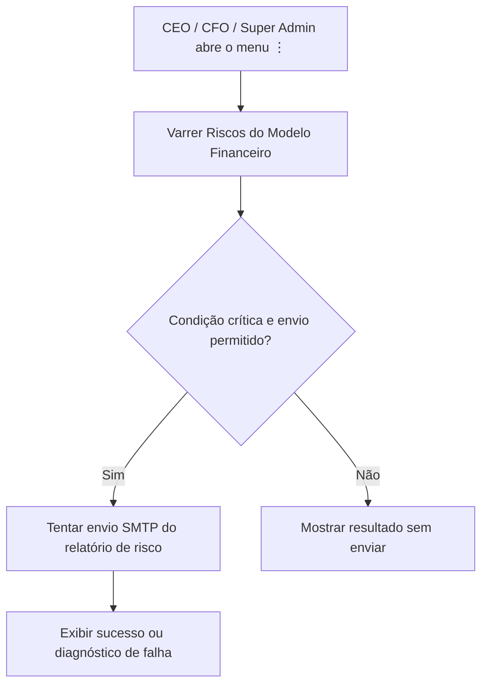

O destinatário principal é o **e-mail do usuário conectado**. O sistema também pode incluir em cópia o endereço de alerta do CEO configurado no projeto. A varredura não usa automaticamente a planilha que você importou para a sessão: ela consulta a base própria do serviço de risco.

A opção **“Simular alerta de risco (forçar e-mail)”** serve para testar um caso de alerta. Mesmo com esse nome, configuração SMTP, rede e controle de repetição ainda podem impedir o envio. Ela não produz novas trajetórias financeiras.

**Para enviar o PDF personalizado ou o memorial:** baixe o arquivo pelo dashboard e anexe-o manualmente no seu aplicativo de e-mail. Esse envio é feito fora do sistema.

## 8. O que acontece por trás da tela?

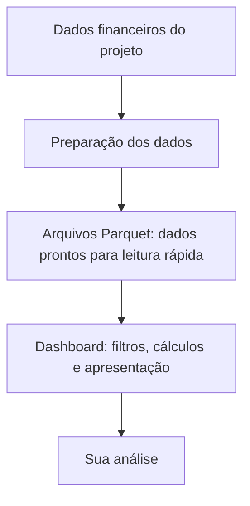

O **Streamlit** apresenta as telas e executa boa parte das análises. O **FastAPI** atende operações como login, usuários, alertas e memorial. O **SQLite** guarda usuários e registros de acesso. Os **Parquets** guardam dados financeiros preparados para evitar reler e recalcular toda a base em cada interação.

Na implantação configurada na Render, frontend e API são serviços separados. Cada um precisa dos próprios arquivos locais; os dados não são compartilhados automaticamente. O suporte a Supabase existe no código, mas está desativado no fluxo atual.

## 9. Um roteiro prático para começar

1. Entre com sua conta.
2. Confira a base selecionada; se necessário, importe ou digite novos dados e clique em aplicar.
3. Escolha um cenário e um ano.
4. Leia os cartões e abra os gráficos; use o botão “+” para acrescentar uma análise do catálogo.
5. Compare cenários e consulte as distribuições de risco quando a visão permitir.
6. Use o chat para esclarecer um indicador.
7. Gere o relatório adequado e baixe o PDF. Para risco, use o menu “⋮” para avaliar e tentar enviar o relatório por e-mail.
8. Clique em sair ao terminar.

Para consultar arquivos, rotas e detalhes técnicos, veja o mapa de engenharia em `VISAO_GERAL_SISTEMA.md`, quando disponível na organização atual do repositório.
