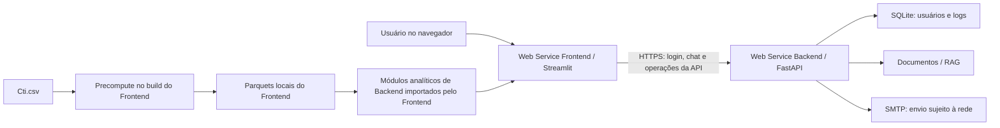
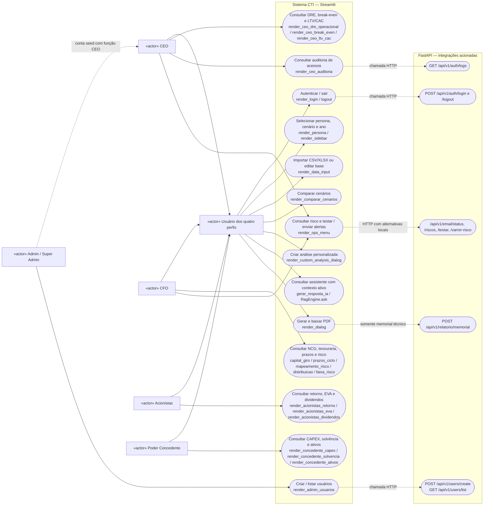
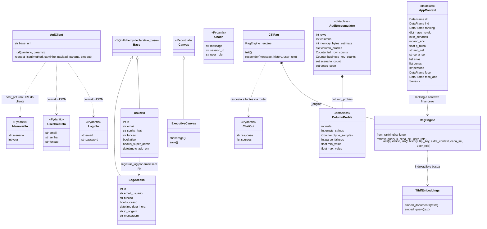
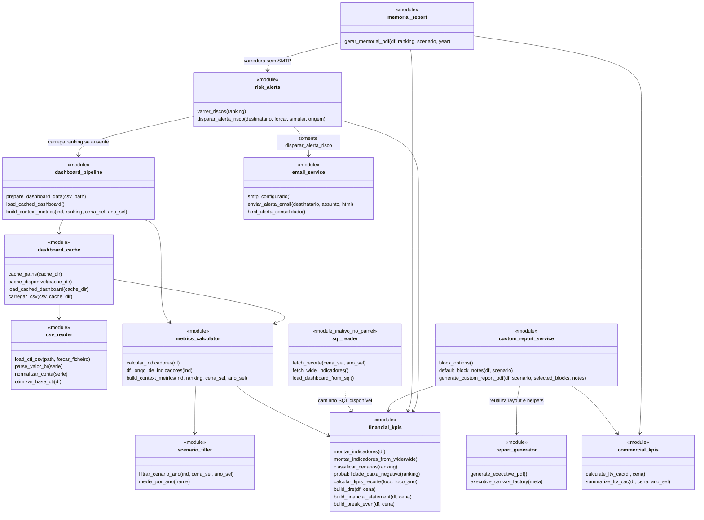
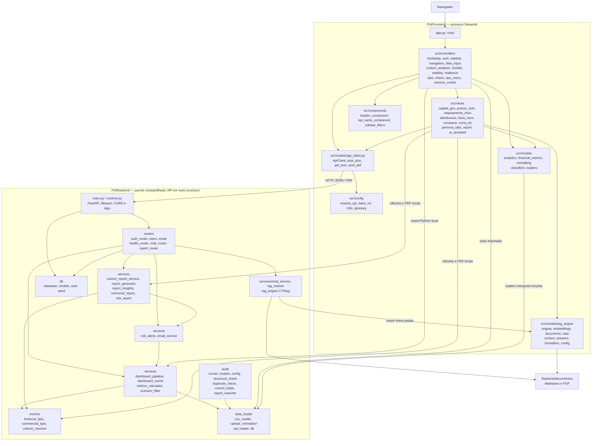
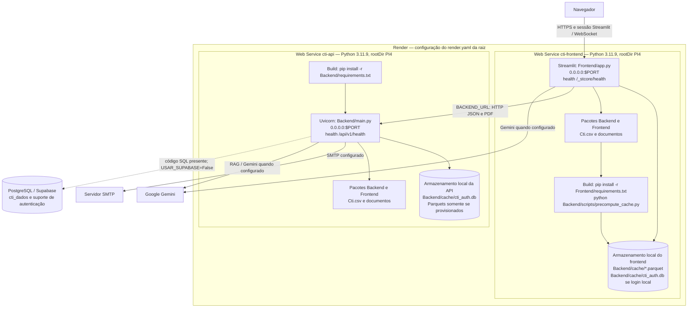
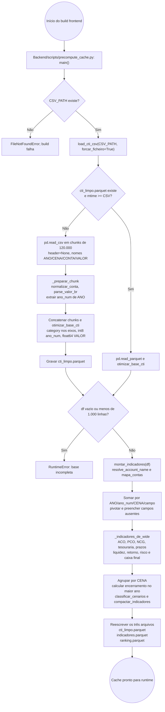
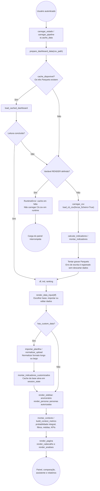

# Blueprinting de Software com UML — CTI

Documento extraído do código atual em 17/10/2026. Escopo: `PI4/Backend`, `PI4/Frontend`, scripts de preparação/auditoria e configurações de execução na raiz. Os diagramas descrevem a implementação encontrada, sem pressupor infraestrutura publicada ou funcionalidades futuras. Os caminhos citados são relativos à raiz do repositório.

## 1. Visão Geral e Arquitetura de Software



O sistema é um dashboard financeiro Streamlit com uma API FastAPI auxiliar. A divisão em pastas **não equivale a uma separação integral por HTTP**: o processo Streamlit importa `Backend.services`, `Backend.metrics` e `Backend.data_loader`. O frontend tem organização em views, controllers e models, mas também consome funções financeiras do backend diretamente. A API importa o motor RAG de `Frontend/src/models`, por meio de `Backend/rag_engine.py`.

| Constatação | Evidência no código |
|---|---|
| Entrada web do painel | `PI4/Frontend/app.py`, função `main()` |
| Entrada HTTP | `PI4/Backend/main.py`, objeto `app`, seis routers registrados |
| Fonte financeira ativa | `services/dashboard_pipeline.py:prepare_dashboard_data()`; Parquet local, com fallback CSV fora da Render |
| PostgreSQL não é a fonte ativa | `data_loader/db.py`: `USAR_SUPABASE = False`; `controllers/bootstrap.py:fonte_sql_ativa()` retorna `False` |
| Monte Carlo é analisado a partir de trajetórias existentes | `metrics/financial_kpis.py` agrega `CENA`, calcula ranking e probabilidade; não há endpoint de geração de novas trajetórias |
| Memorial técnico é remoto | `views/report.py:_render_memorial()` → `post_pdf()` → `POST /api/v1/relatorio/memorial` |
| Executivo personalizado é local | `views/report.py:_gerar_pdf()` → `generate_custom_report_pdf()` no processo Streamlit |
| Autenticação e logs usam banco próprio | `db/models.py`: `Usuario` e `LogAcesso`; SQLite em `Backend/cache/cti_auth.db` no caminho ativo |

Mermaid representa classes e sequências diretamente. Casos de uso, componentes, implantação e atividades usam `flowchart` com limites e rótulos UML adaptados; não se trata de sintaxe UML nativa dessas quatro categorias. Setas tracejadas indicam dependências, alternativas ou extensões explicitadas no contexto. Elementos marcados `module` são módulos de funções, não classes Python inventadas.

## 2. Casos de uso e atores

### 2.1 Papéis reais e alcance das telas

`db/auth.py:FUNCAO_PARA_ROLE` mapeia `CEO`, `CFO`, `Acionistas` e `Poder Concedente` para `ceo`, `cfo`, `acionistas` e `concedente`. `controllers/auth.py:ROLE_PERSONAS` estabelece a hierarquia de telas:

| Ator | Personas permitidas | Funcionalidades específicas |
|---|---|---|
| CEO | CEO, CFO, Acionistas, Concedente | Visão geral, DRE operacional, break-even, LTV/CAC, comparação e logs de acesso |
| CFO | CFO, Acionistas, Concedente | Capital de giro, PMR/PME/PMP e ciclo, risco × retorno, distribuição, faixa de risco, guia de leitura e comparação |
| Acionistas | Acionistas | Retorno/ROIC/ROE, EVA, dividendos/retenção e comparação |
| Poder Concedente | Concedente | CAPEX, solvência, ativos/reversibilidade e comparação |
| Admin (Super Admin) | Conta administrativa sem role `admin`; seed associa função CEO | Criação e listagem de usuários; aba administrativa acrescentada à persona CEO |

O frontend identifica Super Admin pelo e-mail definido em `SUPER_ADMIN_EMAIL`; a API usa `eh_super_admin()`, que aceita a flag `is_super_admin` ou esse e-mail para usuário ativo. Portanto, Admin é uma condição administrativa, não uma quinta função cadastrável. Os rótulos CEO/CFO/CTO no construtor executivo são perfis de apresentação do documento: **CTO não é ator autenticável**. A persona `teste` tem código de sandbox, mas não aparece nas personas permitidas de nenhum role normal.

### 2.2 Diagrama de casos de uso



As associações específicas mostram a persona principal. CEO herda acesso às telas CFO/Acionistas/Concedente e CFO às telas Acionistas/Concedente, conforme a tabela. A importação, o relatório e as análises personalizadas ficam disponíveis no fluxo autenticado sem uma restrição adicional por função nesses pontos. O memorial é bloqueado na interface quando `has_custom_data()` está ativo, pois a API consulta sua própria base CTI.

### 2.3 Contratos HTTP efetivamente registrados

| Método e rota | Handler | Verificação implementada |
|---|---|---|
| GET/HEAD `/`, `/api/health` | `health_root` | Nenhuma; resposta básica |
| GET `/json/version` | `json_version` | Nenhuma |
| GET/HEAD `/api/v1/health` | `health_v1` | Nenhuma; banco, documentos RAG e SMTP |
| POST `/api/v1/auth/login` | `login(LoginIn)` | E-mail, senha e usuário ativo |
| POST `/api/v1/auth/logout` | `logout(LogoutIn)` | Registra saída pelo e-mail recebido |
| GET `/api/v1/auth/logs` | `logs_acesso` | E-mail recebido deve corresponder a CEO ativo |
| POST `/api/v1/users/create` | `criar_usuario(UserCreateIn)` | `_exigir_super_admin(email)` |
| GET `/api/v1/users/list` | `listar_usuarios` | `_exigir_super_admin(email)` |
| POST `/api/v1/email/testar` | `testar_email(EmailTesteIn)` | Executivo CEO/CFO ou Super Admin ativo |
| GET `/api/v1/email/status` | `status_email` | Nenhuma |
| GET `/api/v1/email/riscos` | `consultar_riscos` | `_exigir_executivo(email)` |
| POST `/api/v1/email/varrer-risco` | `varrer_e_alertar(VarreduraIn)` | `_exigir_executivo(email)` |
| POST `/api/chat` | `chat(ChatIn)` | Recebe `user_role` no corpo; sem autenticação vinculada à sessão |
| POST `/api/v1/relatorio/memorial` | `memorial(MemorialIn)` | Validação dos filtros; sem dependência de autenticação |

Esses controles não equivalem a autorização por token: não existe JWT/Bearer emitido no login nem middleware que vincule as chamadas seguintes à identidade autenticada. As rotas administrativas consultam o e-mail informado na query. O RBAC de telas é implementado no Streamlit; o RAG também filtra informações por role recebido.

## 3. Classes, domínio e serviços

### 3.1 Classes Python reais e estruturas transportadas



`Usuario` e `LogAcesso` persistem nas tabelas `usuarios` e `logs_acesso`. Não há chave estrangeira nem `relationship()` entre elas: a associação é pelo texto do e-mail. Os tipos opcionais foram simplificados no desenho; `MemorialIn.year`, `ChatIn.session_id`, `ChatIn.user_role` e alguns campos de log/perfil aceitam ausência. `AppContext.ano_sel` aceita string ou inteiro.

A contabilidade não é modelada em entidades ORM como `Cenario`, `DRE` ou `Simulacao`: usa DataFrames. O domínio financeiro é representado por:

| Estrutura real | Eixos e conteúdo |
|---|---|
| `df` | Base longa: `ANO`, `CENA`, `CONTA`, `VALOR`, `ano_num` |
| `ind` | Linhas por ano/cenário, contas canônicas e KPIs calculados |
| `ranking` | Agregações por `CENA`, `selo`, `caixa_ano12`, `ano_encerramento` e métricas médias |
| `foco`, `foco_ano`, `k` | Recortes e médias produzidos por `build_context_metrics()` |
| `FinancialMetric` | `TypedDict` em `Frontend/src/models/financial_metrics/types.py`; catálogo de métricas para análises |
| Payload de risco | Dicionário com `critical`, `summary`, `reasons`, `checks`, `metrics`; não é classe persistente |

### 3.2 Serviços reais como módulos funcionais



`generate_custom_report_pdf()` não é um wrapper de `generate_executive_pdf()`: constrói o próprio documento ReportLab e reutiliza elementos de `report_generator.py`. `risk_report.py` oferece `gerar_relatorio_riscos()` e `salvar_relatorio_riscos()` como caminho adicional de PDF, distinto do memorial e do construtor personalizado.

### 3.3 Regras financeiras implementadas

- `montar_indicadores()` resolve nomes de contas com `column_resolver.resolve_account_name()`, soma por ano/cenário/campo e pivota a base antes de `_indicadores_de_wide()`.
- `ACO = |contas_receber| + |estoques| + |creditos_tributarios|`; `PCO = |fornecedores + encargos_sociais + tributos_a_pagar|`; `NCG = ACO − PCO`.
- `Saldo_Tesouraria = |disponivel| − |emprestimos_cp|`; PMR, PME e PMP usam 365 dias; `Ciclo_Financeiro = PMR + PME − PMP`.
- A liquidez do ranking é corrente: `|ativo_circ| / |passivo_circ|`; o risco de estrutura é `|total_passivo| / |total_ativo|`. A liquidez geral apresentada ao concedente inclui contas de longo prazo e não é o mesmo indicador.
- O caixa de encerramento usa `saldo_final` quando seu módulo supera `1e-9`, senão `disponivel`. `caixa_ano12` conserva esse nome, mas é calculado no **maior `ano_num` da base**, registrado em `ano_encerramento`.
- `probabilidade_caixa_negativo()` devolve um percentual de 0 a 100: média de `caixa_ano12 < 0` multiplicada por 100. O risco consolidado de `build_context_metrics()` usa o ranking integral, independentemente do filtro visual.
- `classificar_cenarios()` usa quartis de rentabilidade, liquidez, risco, investimentos e distribuição. O selo de caixa insuficiente tem prioridade nas condições.
- `build_dre()` lê EBITDA e resultado operacional das contas informadas. O lucro líquido informado prevalece se seu módulo supera `1e-9`; caso contrário usa EBIT + resultado financeiro + IR/CS. Não se deve substituir isso por uma DRE genérica.
- `build_financial_statement()` aplica `WACC = 0.10`, `PAYOUT = 0.35` e fallback de IR de 34%; calcula NOPAT, capital investido, ROIC, ROE, EVA, dividendos e retenção.
- `calculate_ltv_cac()` busca premissas por aliases e aplica padrões quando ausentes; o serviço comercial tem caminho próprio, além das tabelas auxiliares usadas nas views.
- `varrer_riscos()` avalia probabilidade de ruína, P5 do caixa, liquidez média e participação do selo de caixa insuficiente. Padrões: `RISK_RUIN_THRESHOLD=15` e `RISK_LIQUIDEZ_MIN=1.0`. `simular=True` em alertas altera a varredura para teste; não gera trajetórias Monte Carlo.

## 4. Componentes e módulos



O diagrama agrupa dependências por responsabilidade; os arquivos não representam microsserviços separados. `services/__init__.py` expõe pipeline e carrega relatórios/documentos sob demanda via `__getattr__`. A inicialização do RAG da API é lazy e protegida por `Lock` em `chat_service.py`.

O assistente principal em `views/ai_assistant/panel.py:gerar_resposta_ia()` chama o `RagEngine` **localmente**, com o dataset ativo, ranking, filtros e role. `/api/chat` é outro ponto de entrada: mantém histórico em `_sessoes`, limitado às últimas 12 mensagens por sessão, e usa `CTIRag`. A API não recebe o DataFrame customizado do painel. O motor usa documentos, embeddings TF-IDF, busca vetorial FAISS e integração com Gemini quando disponível, com respostas locais de contingência. `rag_indexer.status_rag()` verifica arquivos documentais; não executa uma inferência para determinar a saúde.

## 5. Sequências reais

### 5.1 Login, auditoria, sessão e fallback

```mermaid
sequenceDiagram
    actor U as Usuário
    participant UI as Streamlit auth.py
    participant C as ApiClient
    participant API as auth_router.login
    participant AUTH as db.auth
    participant DB as SQLite cti_auth.db
    participant R as risk_alerts
    U->>UI: Submeter e-mail e senha em render_login()
    UI->>UI: authenticate(); proteção _cti_login_in_flight
    UI->>C: post_json(/api/v1/auth/login, timeout=20)
    C->>API: POST LoginIn {email, password}
    API->>AUTH: autenticar(db, email, password, ip_origem)
    AUTH->>DB: Buscar Usuario por e-mail normalizado
    AUTH->>AUTH: Verificar ativo e PBKDF2-HMAC-SHA256
    AUTH->>DB: registrar_log() em LogAcesso
    alt Credenciais inválidas
        API-->>C: 401 detail
        C-->>UI: payload, status
        UI-->>U: st.error()
    else Credenciais válidas
        API->>AUTH: usuario_publico(usuario)
        opt CEO, CFO ou Super Admin
            API->>API: BackgroundTasks.add_task(_alerta_risco_em_fundo)
        end
        API-->>C: 200 {ok, message, user, risk_alert:null}
        C-->>UI: payload, status
        UI->>UI: _abrir_sessao() / _aplicar_usuario()
        UI->>UI: session_state authenticated, role, email, funcao
        UI-->>U: st.rerun() abre o painel
        opt Tarefa de alerta agendada
            API->>R: disparar_alerta_risco(origem=login)
            R->>R: varrer_riscos; criticidade e debounce
            Note over R: SMTP somente se condições permitirem; falha não invalida login
        end
    end
    opt Cliente retorna status 503
        C-->>UI: Timeout / conexão indisponível / resposta 503
        UI->>UI: _autenticar_local()
        UI->>AUTH: seed_usuarios(); autenticar_db()
        AUTH->>DB: Banco do processo Streamlit
        Note over UI,DB: Nos dois serviços Render, é outra cópia local do banco
        AUTH-->>UI: usuario_publico ou falha
        UI->>UI: _abrir_sessao() se válido
    end
```

A senha usa salt aleatório e 120.000 iterações; logs armazenam sucesso/falha, função, horário e origem. `session_scope()` confirma a transação ou faz rollback e fecha a sessão. Logout chama a API para registrar a saída e limpa `st.session_state`, preservando idioma.

Existem `session_cookie.py` e funções `restore_persistent_session()` / `refresh_session_cookie()` com cookie assinado e TTL de cinco minutos. Entretanto, o fluxo atual de `app.main()`, `render_login()` e `_abrir_sessao()` não as aciona para restaurar/gravar sessão. Por isso, o diagrama usa a sessão Streamlit efetivamente aplicada, sem inventar um fluxo ativo de cookie ou JWT.

### 5.2 Consulta das trajetórias chamadas Monte Carlo no painel

```mermaid
sequenceDiagram
    actor U as Usuário autenticado
    participant APP as app.main
    participant B as controllers.bootstrap
    participant P as dashboard_pipeline
    participant K as financial_kpis / scenario_filter
    participant S as Parquet ou CSV local
    participant V as Views Streamlit
    U->>APP: Abrir painel ou alterar filtros
    APP->>B: carregar_estado()
    B->>B: carregar_pipeline() com st.cache_data
    opt Cache Streamlit sem resultado
        B->>P: prepare_dashboard_data(CSV_PATH)
        P->>S: Ler três Parquets
        alt Parquet ausente ou falhou fora da Render
            P->>S: carregar_csv() / load_cti_csv(forcar_ficheiro=True)
            P->>K: montar_indicadores(df)
            K-->>P: ind, ranking
        else Cache indisponível na Render
            P-->>B: RuntimeError; CSV bloqueado em runtime
        end
        P-->>B: df, ind, ranking
    end
    B-->>APP: Estado financeiro
    APP->>APP: render_data_input(); render_sidebar(); render_persona()
    opt Dataset customizado
        APP->>K: montar_indicadores_customizados(df) chama montar_indicadores
        K-->>APP: ind, ranking da base ativa
    end
    APP->>B: montar_contexto(df, ind, ranking, filtros, persona)
    B->>P: build_context_metrics() via cache para base padrão
    P->>K: probabilidade_caixa_negativo(ranking)
    P->>K: filtrar_cenario_ano(); calcular_kpis_recorte()
    P-->>B: ano_enc, p_ruina, foco, foco_ano, k
    B-->>APP: AppContext
    APP->>V: render_pagina(ctx)
    V-->>U: KPIs, histogramas, percentis, envelopes e comparação
    Note over APP,S: Sem chamada HTTP de simulação; CENA identifica trajetórias já existentes
```

Na base padrão, `_metricas_padrao()` reutiliza os dados cacheados. A seleção `Todos` resulta em médias por ano para o contexto; nos demonstrativos, `_wide()` usa média por ano/conta para todos os cenários e soma para cenário específico.

### 5.3 Memorial técnico remoto e download

```mermaid
sequenceDiagram
    actor U as Usuário
    participant V as views.report
    participant C as api_client.post_pdf
    participant API as report_router.memorial
    participant P as dashboard_pipeline
    participant M as memorial_report
    participant K as Metrics e risk_alerts
    U->>V: Gerar Memorial CTI (PDF)
    V->>V: Validar base padrão e montar scenario/year
    V->>C: post_pdf(/api/v1/relatorio/memorial, filters)
    C->>API: POST MemorialIn; timeout=120
    API->>P: prepare_dashboard_data()
    P-->>API: df, ind, ranking da API
    API->>M: gerar_memorial_pdf(df, ranking, scenario, year)
    M->>M: Validar cenário e ano disponíveis
    M->>K: build_dre / build_break_even / build_financial_statement
    M->>K: calculate_ltv_cac / _wide
    M->>M: Aplicar filtro anual após cálculos
    M->>K: varrer_riscos(ranking integral)
    Note over M,K: Risco consolidado não depende do cenário/ano escolhido; não envia SMTP
    M->>M: SimpleDocTemplate.build() em BytesIO
    M-->>API: bytes PDF
    API-->>C: application/pdf; attachment; Cache-Control:no-store
    C->>C: Validar Content-Type e prefixo %PDF-
    C-->>V: bytes
    V->>V: session_state memorial_api_download por filtros
    V-->>U: st.download_button()
    Note over API,M: ValueError → 422; OSError/RuntimeError → 503
    Note over V,C: Alterar filtros invalida download anterior; erro exibido no painel
```

### 5.4 Executivo personalizado local

```mermaid
sequenceDiagram
    actor U as Usuário
    participant V as views.report
    participant SS as st.session_state
    participant S as custom_report_service
    participant H as report_generator / report_insights
    U->>V: Selecionar Executivo personalizado, blocos e pareceres
    V->>SS: Guardar payload em _cti_report_pending
    V->>V: Rerun do app
    V->>V: flush_pending_pdf() fora do st.dialog
    V->>V: _gerar_pdf(); _df_relatorio(); _frames_relatorio()
    Note over V: Usa override importado quando ativo; senão carregar_pipeline()
    V->>S: generate_custom_report_pdf(..., skip_charts=True, use_llm=False)
    S->>H: insights_from_tables / merge_notes_with_insights
    S->>H: masthead, side_by_side e demais helpers de layout
    S->>S: Montar blocos e documento ReportLab em memória
    S-->>V: bytes PDF
    V->>SS: custom_report_pdf, filename, páginas de preview
    V-->>U: Pré-visualização e st.download_button()
    Note over V,S: Sem rota FastAPI para este fluxo; perfil CTO é opção editorial
```

O construtor pode comparar até três cenários extras preparados em `_gerar_pdf()`. O fluxo fornece cenário, blocos e notas ao serviço; o ano visível no painel não é passado como parâmetro de recorte para `generate_custom_report_pdf()`. O memorial remoto é o caminho que recebe `year` explicitamente.

## 6. Implantação e armazenamento

### 6.1 Blueprint de dois serviços na Render



Os dois serviços usam `plan: free`. O documento descreve o manifesto do repositório, não uma confirmação de serviços efetivamente publicados. `FRONTEND_URL`/`CORS_ORIGINS`/`CORS_ORIGIN_REGEX` configuram CORS na API; `BACKEND_URL`, `API_URL`, `CTI_API_URL`, nessa prioridade, resolvem o destino HTTP do frontend. Sem configuração, `resolve_api_base_url()` usa host local e porta 8000 por padrão.

**Lacuna concreta de provisionamento:** o build da API no manifesto da raiz não executa precompute. Não existe volume compartilhado nem disco persistente declarado. Os arquivos gerados no serviço frontend não aparecem automaticamente no serviço API. Como `prepare_dashboard_data()` bloqueia CSV em runtime quando `RENDER` está definido, o memorial e a varredura da API precisam de seus próprios três Parquets disponíveis. Caso contrário, o memorial devolve 503; o alerta em background registra a falha e preserva o login. A disponibilidade do health check não prova que o pipeline financeiro da API tem cache: o handler verifica banco e documentos, não os três Parquets.

`db/database.py` usa SQLite local com Supabase desligado mesmo que exista `DATABASE_URL`. O código contém conexão PostgreSQL e contingência para SQLite durante `init_db()`, mas isso não torna o PostgreSQL ativo. O banco financeiro `cti_dados` pertence ao leitor SQL opcional; não se deve confundi-lo com as tabelas de autenticação. No fallback de login, o Streamlit consulta seu próprio banco: contas criadas na API não são automaticamente replicadas para ele.

### 6.2 Formas alternativas de iniciar presentes no repositório

| Arquivo | Comportamento real |
|---|---|
| `render.yaml` | Blueprint principal de dois Web Services |
| `PI4/Backend/render.yaml` | Blueprint apenas da API, `rootDir: PI4/Backend`, sem precompute; não conserva o pacote Frontend no mesmo root de implantação |
| `Procfile` da raiz + `start.sh` | Alternativa de um serviço: Uvicorn em background na porta interna 8081 e Streamlit na porta pública; define `BACKEND_URL` local e `RENDER` |
| `PI4/Backend/Procfile` | Uvicorn `main:app` |
| `PI4/Frontend/Procfile` | Streamlit `app.py` |
| `requirements.txt` e `PI4/requirements.txt` | Entradas de dependências do projeto; `Frontend/requirements.txt` inclui `../Backend/requirements.txt` |
| `.python-version`, `runtime.txt` | Configurações auxiliares da versão Python |

A API usa `CTIRag` que importa `src.models.rag_engine` da pasta Frontend. Portanto, o blueprint isolado em `Backend/render.yaml` tem uma limitação adicional para o chat se somente esse root for disponibilizado. O manifesto da raiz preserva ambos os pacotes em `PI4`.

## 7. Atividades do pipeline de dados

### 7.1 Preparação no build



O script de build reescreve os três arquivos ao concluir; o leitor pode reutilizar o Parquet bruto atualizado em vez de reler o CSV. `PI4/scripts/precompute_cache.py` é um encaminhador por `runpy` para o script real do Backend.

### 7.2 Runtime, falhas e consumo visual



`load_cached_dashboard()` isoladamente consegue reconstruir parte da base longa a partir de indicadores se o bruto estiver ausente/vazio, usando `df_longo_de_indicadores()`. Porém `prepare_dashboard_data()` primeiro exige a existência dos três arquivos: a ausência de `cti_limpo.parquet` impede a entrada normal nesse leitor. A reconstrução também não recupera todas as contas do CSV; DRE e break-even podem ficar incompletos. Não é correto desenhar uma contingência completa e transparente de qualquer cache ausente para indicadores.

`carregar_csv()` grava indicadores e ranking e só grava o bruto ali se ainda não existir; o próprio leitor CSV também mantém seu Parquet. O pipeline runtime não compara sistematicamente as datas dos três caches com o CSV antes de aceitar o conjunto. A atualização controlada ocorre no precompute.

## 8. Fluxos auxiliares e fronteiras do blueprint

### 8.1 Auditoria de dados e scripts

`Backend/data_audit.py` oferece CLI sobre `audit.runner.run_audit()`. O runner escolhe CSV ou SQL, lê em chunks e acumula `AuditAccumulator`: `structural_check` verifica estrutura, valores ausentes, conversões e anomalias; `duplicate_check` conta duplicatas completas e por chave; `control_totals` acumula contas e totais; `report_exporter` formata/salva resultados. Esse caminho é distinto de `render_ceo_auditoria()`, que consulta **logs de acesso** pela API.

`scripts/migrar_para_supabase.py` contém migração para o banco SQL, mas sua existência não ativa a fonte SQL do painel. `Backend/scripts/seed_usuarios.py` é uma entrada de seed. `PI4/scripts/gerar_memorial_cti.py` produz documentação de cálculo offline; os arquivos em `Backend/relatorios` são artefatos e não substituem a geração dinâmica da rota de memorial.

Os notebooks `Frontend/analise.ipynb` e `organizando.ipynb` são material exploratório, fora do caminho de entrada `app.py`. `Frontend/chat_component.py` e `chat_widget.html` coexistem com o assistente modular; o fluxo principal atual chama `src.views.ai_assistant.panel.render_floating_chat()`.

### 8.2 Resiliência implementada

- `runtime.lifespan()` tenta inicializar banco e seed e registra falhas sem necessariamente impedir a API de subir.
- `ApiClient.request_json()` executa uma chamada por ação, sem retentativas automáticas; falhas de rede/timeouts retornam status 503 ao controller. `post_pdf()` propaga diagnóstico e valida o binário recebido.
- `controllers/resilience.py` fornece `safe_render()` / `resilient_view()` para isolar falhas de renderização; `app.main()` também trata exceções na montagem da página.
- `ops_menu.py` tem alternativas locais para diagnóstico/envio; a presença de código compartilhado permite execução no processo Streamlit.
- `disparar_alerta_risco()` consolida um e-mail, considera criticidade e evita repetições com estruturas em memória. Padrões de debounce: 900 segundos no login e 45 no acionamento manual. `_LOGIN_ENVIADO` não representa uma sessão autenticada persistida no banco.
- `FORCE_EMAIL_ALERT_ON_LOGIN` habilita simulação de alerta para teste. Sem SMTP configurado, o sistema produz diagnóstico; a geração do memorial não tenta enviar e-mail.

## 9. Rastreabilidade e verificação

| Área do relatório | Fontes principais |
|---|---|
| Atores e telas | `Backend/db/auth.py`, `Frontend/src/controllers/auth.py`, `sidebar.py`, `navigation.py`, `views/persona_tabs/*` |
| Autenticação e persistência | `Backend/db/models.py`, `database.py`, `seed.py`, `routers/auth_router.py`, `routers/users.py`, `Frontend/src/controllers/session_cookie.py` |
| Pipeline e cache | `Backend/services/dashboard_pipeline.py`, `dashboard_cache.py`, `metrics_calculator.py`, `scenario_filter.py`, `Backend/scripts/precompute_cache.py` |
| Fontes CSV/SQL/upload | `Backend/data_loader/csv_reader.py`, `sql_reader.py`, `db.py`, `upload_normalizer.py`, `Frontend/src/controllers/data_input.py` |
| Domínio financeiro | `Backend/metrics/financial_kpis.py`, `commercial_kpis.py`, `column_resolver.py`, `Frontend/src/models/financial_metrics/*` |
| Relatórios | `Backend/routers/report_router.py`, `services/memorial_report.py`, `custom_report_service.py`, `report_generator.py`, `report_insights.py`, `risk_report.py`, `Frontend/src/views/report.py` |
| Alertas e e-mail | `Backend/routers/email.py`, `services/risk_alerts.py`, `email_service.py`, `Frontend/src/controllers/ops_menu.py` |
| Chat | `Backend/routers/chat_router.py`, `services/chat_service.py`, `rag_indexer.py`, `Backend/rag_engine.py`, `Frontend/src/models/rag_engine/*`, `views/ai_assistant/*` |
| Auditoria offline | `Backend/data_audit.py`, `Backend/audit/*` |
| Implantação | `render.yaml`, `start.sh`, os três `Procfile`, `Backend/render.yaml` e arquivos de dependências |

A suíte existente em `Backend/tests` documenta contratos e regressões de pipeline, API, memorial, notas de relatório, desempenho e PDF de risco. `test_api_contracts.py` enumera os 15 caminhos HTTP de negócio/saúde acima e verifica login, logs, CORS e histórico do chat; `test_memorial_api.py` cobre o endpoint PDF. São evidências adicionais do comportamento pretendido pelo código, não prova de disponibilidade da implantação.

Este blueprint é uma análise estática do estado de trabalho. Não pressupõe execução bem-sucedida de serviços externos, sincronização de bancos locais, cache compartilhado, implantação já publicada ou execução de uma simulação estocástica ausente do fluxo implementado.
