# Visão Geral e Arquitetura de Software — CTI

O CTI é um painel financeiro que analisa os cenários existentes em `Cti.csv`. O diagrama reúne o projeto em uma única visão: acesso por perfil, frontend Streamlit, API FastAPI, processamento financeiro, armazenamento, relatórios e integrações.

```mermaid
flowchart TB
    subgraph ATORES["Quem utiliza o sistema"]
        CEO["CEO: visão executiva e auditoria de acessos"]
        CFO["CFO: capital de giro, prazos e risco"]
        AC["Acionistas: retorno, EVA e dividendos"]
        PC["Poder Concedente: CAPEX, solvência e ativos"]
        ADM["Super Admin: conta administrativa com função CEO"]
    end

    U["Usuário no navegador"]
    CEO & CFO & AC & PC & ADM --> U

    subgraph FRONT["Render: cti-frontend — Web Service Streamlit"]
        APP["Frontend/app.py: main()"]
        AUTH["controllers/auth.py
Login, logout e sessão Streamlit
ROLE_PERSONAS controla acesso às telas"]
        CTRL["Controllers
bootstrap: carregar_estado e montar_contexto
sidebar: filtros de cenário, ano e persona
navigation: render_pagina"]
        VIEWS["Views e componentes
CEO: DRE, break-even e LTV/CAC
CFO: NCG, tesouraria, ciclos, distribuição e risco
Acionistas: ROIC, ROE, EVA e dividendos
Concedente: CAPEX, liquidez e ativos
Comparação e análises personalizadas"]
        INPUT["controllers/data_input.py
Importação CSV/XLSX e edição manual
Dataset ativo em session_state"]
        MODELS["Models
analytics, financial_metrics e formatting
Séries, catálogos, resumos e formatação"]
        CLIENT["models/api_client.py
ApiClient, get_json, post_json e post_pdf"]
        LOCALCHAT["views/ai_assistant/panel.py
gerar_resposta_ia
Contexto da base ativa e dos filtros"]
        EXEC["views/report.py
Executivo personalizado: _gerar_pdf
Prévia e download no Streamlit"]
        MEMUI["views/report.py: _render_memorial
Memorial técnico da base padrão
Download do PDF recebido da API"]
        ADMINUI["views/persona_tabs
admin_users: criar e listar usuários
audit: consultar logs de acesso"]
        OPS["controllers/ops_menu.py
Diagnóstico SMTP e varredura de risco
Chamadas HTTP com alternativas locais"]
        FCACHE[("Cache local do frontend
cti_limpo.parquet
indicadores.parquet
ranking.parquet
st.cache_data para reutilização")]
        FDB[("SQLite local do frontend
cti_auth.db
Usado no fallback de login")]
        APP --> AUTH
        AUTH -->|"Após autenticação"| CTRL
        CTRL --> INPUT & VIEWS & ADMINUI & OPS
        INPUT --> VIEWS
        MODELS --> VIEWS
        VIEWS --> LOCALCHAT & EXEC & MEMUI
        AUTH & ADMINUI & OPS & MEMUI --> CLIENT
    end

    U -->|"Interface web e WebSocket"| APP

    subgraph SHARED["Pacote Backend importado também pelo Streamlit"]
        PIPE["services/dashboard_pipeline.py
prepare_dashboard_data
Orquestra leitura de dados e cache"]
        CACHE["services/dashboard_cache.py
load_cached_dashboard / carregar_csv"]
        LOADER["data_loader/csv_reader.py
load_cti_csv, parse_valor_br
normalizar_conta, otimizar_base_cti"]
        UPLOAD["data_loader/upload_normalizer.py
importar_planilha / normalizar_upload
Formatos largo e longo"]
        MET["metrics/financial_kpis.py e commercial_kpis.py
montar_indicadores / classificar_cenarios
build_dre / build_break_even
build_financial_statement / calculate_ltv_cac"]
        CONTEXT["services/metrics_calculator.py e scenario_filter.py
build_context_metrics / filtrar_cenario_ano
Probabilidade de caixa negativo, recortes e médias"]
        CUSTOMPDF["services/custom_report_service.py
generate_custom_report_pdf
Blocos, notas e comparação de cenários
report_generator e report_insights: layout e pareceres"]
        AUDIT["data_audit.py e audit/runner.py
run_audit: estrutura, duplicatas
anomalias e totais de controle
Exportação da auditoria de dados"]
        SQL["data_loader/sql_reader.py e db.py
Leitor SQL e suporte PostgreSQL/Supabase
Inativos no pipeline atual: USAR_SUPABASE=False"]
        PIPE --> CACHE
        CACHE --> LOADER & MET
        MET --> CONTEXT
        CUSTOMPDF --> MET
    end

    CTRL -->|"Import Python local"| PIPE
    PIPE --> FCACHE
    CTRL -->|"montar_contexto"| CONTEXT
    CONTEXT --> VIEWS
    INPUT --> UPLOAD
    UPLOAD -->|"Recalcular indicadores da base importada"| MET
    EXEC -->|"Geração local, sem chamada FastAPI"| CUSTOMPDF

    subgraph BUILD["Preparação e scripts"]
        CSV[("Backend/Cti.csv
ANO, CENA, CONTA e VALOR
Trajetórias financeiras já existentes")]
        PRE["Backend/scripts/precompute_cache.py
Executado no build do frontend
Leitura em chunks, normalização
cálculo de indicadores e ranking"]
        WRAP["PI4/scripts/precompute_cache.py
Encaminha ao precompute do Backend"]
        SEED["db/seed.py e scripts/seed_usuarios.py
Inicialização dos usuários"]
        MIG["scripts/migrar_para_supabase.py
Migração SQL opcional"]
        OFF["PI4/scripts/gerar_memorial_cti.py
Documentação de cálculo offline"]
        CSV --> PRE
        WRAP --> PRE
        PRE --> LOADER & MET
        PRE -->|"Grava os três Parquets"| FCACHE
        CSV --> AUDIT & OFF
        MIG -.-> SQL
    end

    subgraph API["Render: cti-api — Web Service FastAPI"]
        MAIN["Backend/main.py e runtime.py
FastAPI, lifespan, CORS e logs
Inicializa banco e seed"]
        AR["routers/auth_router.py
POST /api/v1/auth/login e /logout
GET /api/v1/auth/logs"]
        UR["routers/users.py
POST /api/v1/users/create
GET /api/v1/users/list"]
        ER["routers/email.py
/api/v1/email/status e /testar
/riscos e /varrer-risco"]
        CR["routers/chat_router.py
POST /api/chat
services/chat_service.py
Histórico em memória por session_id"]
        RR["routers/report_router.py
POST /api/v1/relatorio/memorial
scenario e year validados"]
        HEALTH["routers/health_router.py
/, /api/health, /api/v1/health
/json/version"]
        DBA["db/auth.py, database.py e models.py
PBKDF2 para senha e SQLAlchemy
Usuario e LogAcesso
Verificações de função e Super Admin"]
        ADB[("SQLite da API
Backend/cache/cti_auth.db
Tabelas usuarios e logs_acesso")]
        APQ[("Parquets locais da API
Precisam ser provisionados neste serviço
Não são compartilhados com o frontend")]
        RISK["services/risk_alerts.py
varrer_riscos / disparar_alerta_risco
Ruína, P5, liquidez e selos
Criticidade e prevenção de envios repetidos"]
        EMAIL["services/email_service.py
enviar_alerta_email
SMTP configurado e rede disponível"]
        MEM["services/memorial_report.py
gerar_memorial_pdf
DRE, eficiência, risco e solvência
ReportLab gera PDF em memória"]
        RISKPDF["services/risk_report.py
gerar_relatorio_riscos / salvar_relatorio_riscos
Utilitário adicional de PDF de risco"]
        CTIRAG["Backend/rag_engine.py: CTIRag
Reutiliza RagEngine do Frontend
Ranking local da API"]
        MAIN --> AR & UR & ER & CR & RR & HEALTH
        AR & UR --> DBA
        DBA --> ADB
        MAIN --> SEED
        SEED --> DBA
        AR -->|"Tarefa em background para executivos"| RISK
        ER --> RISK & EMAIL
        RISK --> EMAIL
        RISK -->|"Carga de ranking"| PIPE
        RR -->|"Carga da base no processo API"| PIPE
        PIPE -->|"Quando chamado pela API"| APQ
        RR --> MEM
        MEM --> MET
        MEM -->|"Varredura sem envio de e-mail"| RISK
        CR --> CTIRAG
        RISK -. "Payload de varredura" .-> RISKPDF
    end

    CLIENT -->|"HTTP/HTTPS: login, usuários, alertas e memorial"| MAIN
    AUTH -. "Status 503: autenticação local" .-> FDB
    FDB -. "Mesmas funções de autenticação" .-> DBA
    MEM -->|"PDF retornado pela API"| MEMUI

    subgraph IA["Assistente e integrações externas"]
        RAG["Frontend/src/models/rag_engine
RagEngine.from_ranking / retrieve / ask
TF-IDF, FAISS e filtro por role
Respostas locais de contingência"]
        DOCS[("Backend/documentos
Markdown e PDF
Manuais, contas, indicadores e cenários")]
        GEMINI["Google Gemini
Geração de respostas quando configurado"]
        SMTP["Servidor SMTP
Entrega de e-mails sujeita à rede"]
        RAG --> DOCS
        RAG --> GEMINI
    end
    LOCALCHAT -->|"Chamada local com dataset ativo"| RAG
    CTIRAG --> RAG
    EMAIL --> SMTP
```

**Como interpretar:** o Streamlit importa os cálculos do pacote `Backend` diretamente e usa HTTP para operações da API. O assistente principal do painel também roda localmente; `/api/chat` oferece uma entrada adicional. O relatório executivo é local, enquanto o memorial técnico é gerado pela API.

**Dados e implantação:** os cenários Monte Carlo já estão na base; o fluxo atual não gera novas trajetórias. O `render.yaml` da raiz define dois serviços independentes e executa precompute apenas no frontend. A API precisa dos próprios Parquets para o memorial e os alertas. Na Render, o pipeline bloqueia a leitura do CSV em runtime; fora dela, existe fallback para CSV. Os bancos SQLite dos dois serviços também são independentes. `start.sh` oferece uma alternativa de execução conjunta, com FastAPI interna e Streamlit na porta pública.

**Acesso:** CEO pode consultar todas as personas; CFO pode consultar CFO, Acionistas e Concedente. Acionistas e Concedente acessam suas respectivas personas. Super Admin acrescenta gestão de usuários. A API não emite JWT: as verificações administrativas consultam o e-mail informado nas requisições. A auditoria de dados por CLI é diferente da consulta de logs de acesso na tela CEO.
