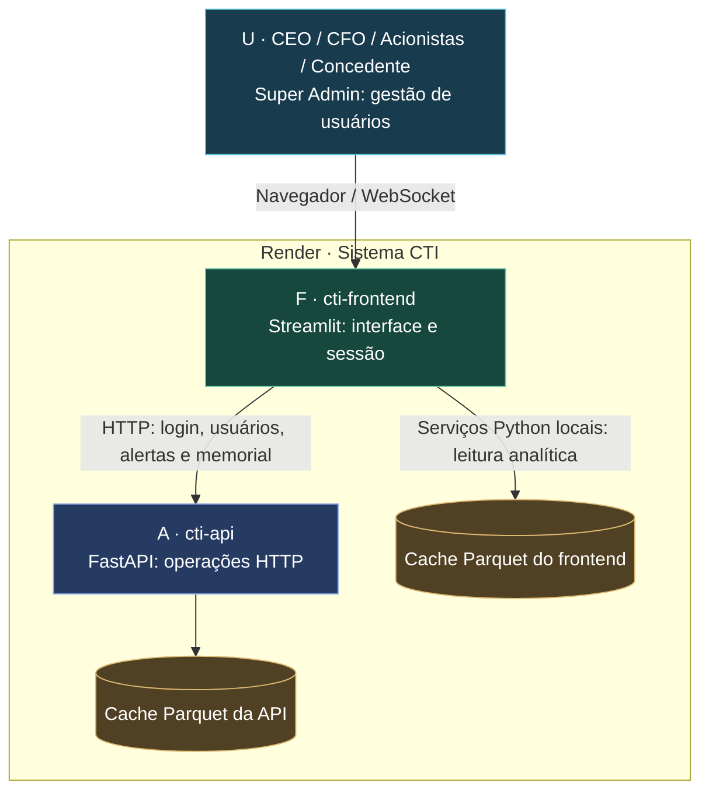
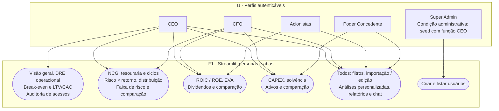
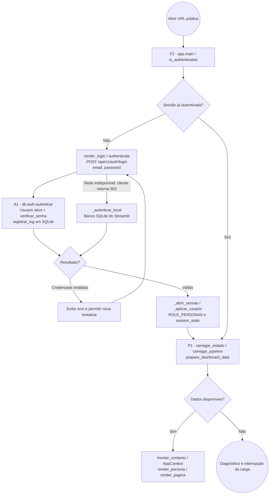
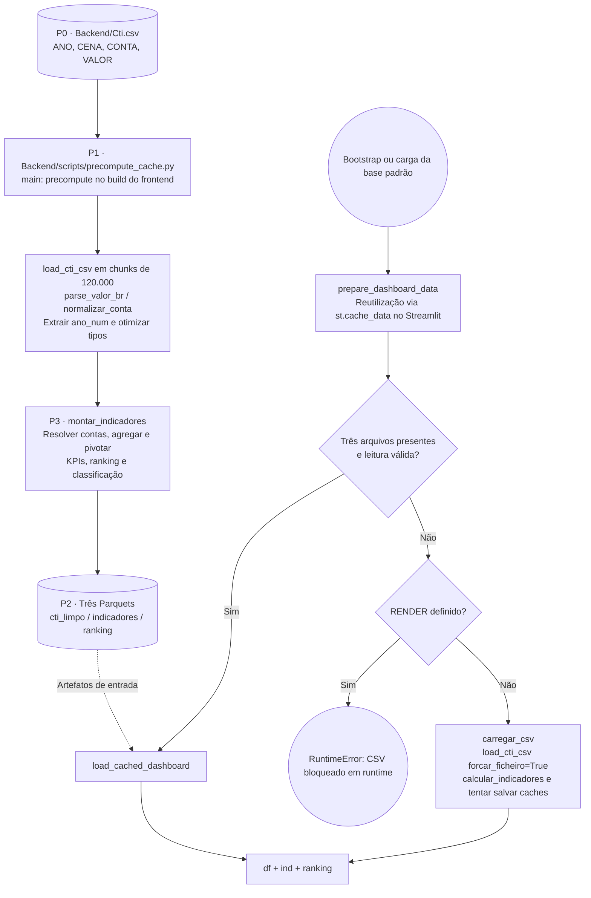
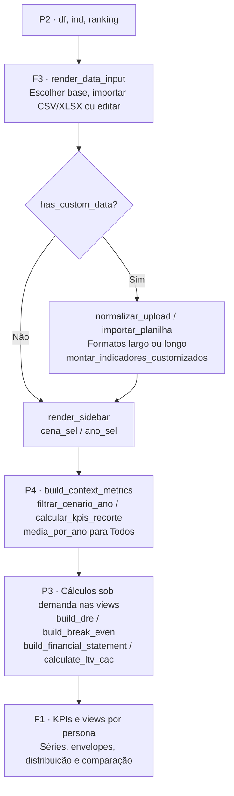
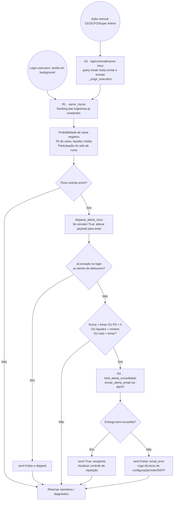
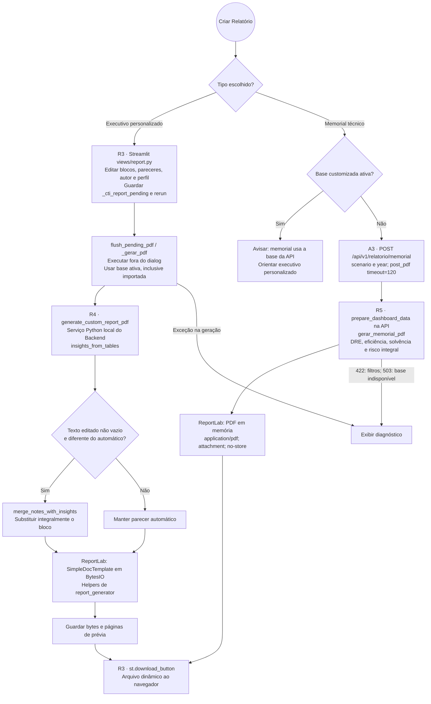
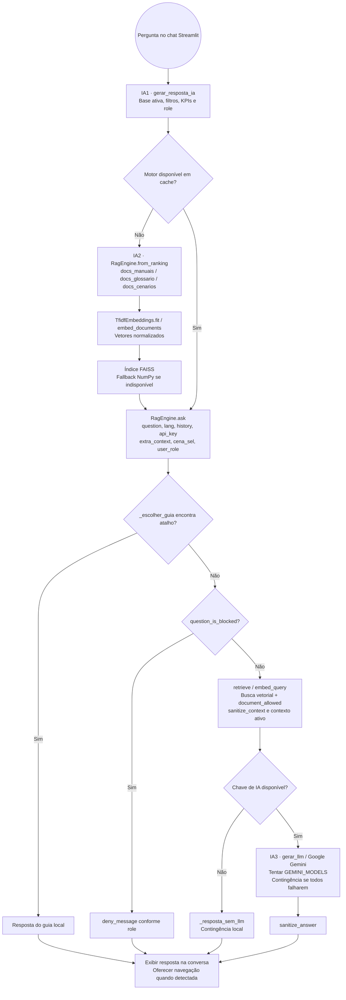
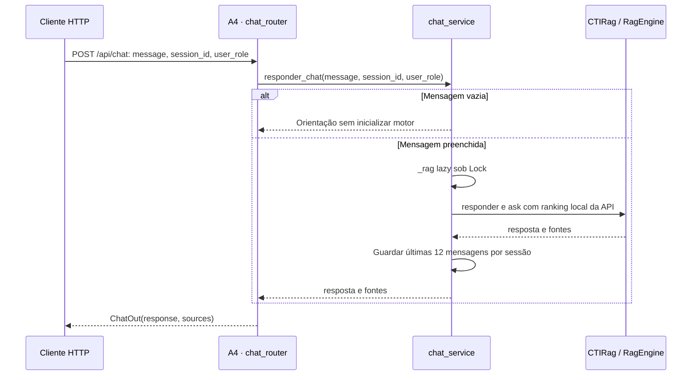

# Visão geral do sistema — Dashboard Financeiro CTI

Mapa completo do projeto em um único documento. O desenho inicial mostra a arquitetura macro; os quatro menus abaixo permitem explorar cada responsabilidade sem reduzir tudo a um diagrama gigante. As tabelas finais ligam componentes, arquivos, funções e rotas.

Os diagramas usam Mermaid nativo do Markdown. Casos de uso, arquitetura C4 e processos são representações adaptadas em `flowchart`; eventos e decisões não constituem um arquivo BPMN executável. Identificadores como `P1`, `R1` e `IA1` conectam os desenhos à matriz final. Setas com rótulo **HTTP** atravessam a API; chamadas por **import Python** executam no processo chamador.

## Visão geral macro — C4, níveis 1 e 2

O CTI permite consultar cenários financeiros, indicadores, riscos, relatórios e documentação por perfil. O limite Render contém dois serviços, cada um com armazenamento local próprio.

**Leitura essencial:** Streamlit importa serviços do pacote `Backend`; nem toda operação passa pelo FastAPI. O executivo personalizado e o chat principal executam localmente. O memorial técnico usa a API. Os cenários Monte Carlo já existem em `Cti.csv`; o fluxo implementado analisa trajetórias, sem gerar uma nova simulação.

## Detalhamento módulo por módulo

<b>🔍 Clique para expandir: 1. Diagrama de Casos de Uso & Perfis (RBAC)</b>

### Perfis e funcionalidades

`ROLE_PERSONAS` em `controllers/auth.py` define essa hierarquia; `navigation.py:PERSONA_NAV_KEYS` define as abas. O Super Admin do seed também tem acesso CEO. O perfil editorial CTO do relatório não é uma função autenticável. A persona de sandbox `teste` tem código próprio, mas não faz parte das personas permitidas aos roles normais.

### Autenticação e bootstrap

- `Usuario` e `LogAcesso` são classes SQLAlchemy em `Backend/db/models.py`; não possuem chave estrangeira entre si. A associação de auditoria usa o texto do e-mail.
- `verificar_senha()` usa PBKDF2-HMAC-SHA256, salt e 120.000 iterações. `session_scope()` aplica commit ou rollback e fecha a sessão.
- O login retorna `user`, sem emitir JWT. Rotas de administração e alertas verificam o e-mail recebido na query; isso não equivale a vincular cada chamada à identidade por token.
- O fallback local acontece em 503, não em rejeição de credenciais 401. Os SQLite dos dois serviços não são sincronizados automaticamente.
- Funções de cookie persistente existem, mas não são acionadas pelo fluxo principal de login atual. Logout registra saída pela API e limpa a sessão preservando idioma.
- Login CEO/CFO ou Super Admin agenda alerta em background; uma falha nessa tarefa não invalida o login. Os logs de acesso são consultados pela aba CEO.

<b>⚙️ Clique para expandir: 2. Pipeline de Dados, Cache Parquet & Fallbacks</b>

### Preparação dos dados e leitura em runtime

O precompute rejeita base vazia ou com menos de 1.000 linhas e reescreve os três Parquets. O leitor pode reutilizar o Parquet bruto quando seu `mtime` é mais recente que o CSV. O teste normal de disponibilidade do pipeline exige os três arquivos; o runtime não revalida sistematicamente as datas de todos eles.

`load_cached_dashboard()` isoladamente permite reconstrução parcial da base longa por `df_longo_de_indicadores()`. Porém, a ausência do arquivo bruto impede a entrada normal pelo teste dos três arquivos. A reconstrução não recupera todas as contas necessárias à DRE e ao break-even.

### Dataset ativo, recortes e domínio financeiro

| Estrutura / regra | Implementação real |
|---|---|
| `df` | Base longa: `ANO`, `CENA`, `CONTA`, `VALOR`, `ano_num` |
| `ind` | Contas canônicas e KPIs por cenário/ano |
| `ranking` | Médias por cenário, selo, caixa de encerramento e `ano_encerramento` |
| `AppContext` | Dataclass com base, indicadores, ranking, filtros, persona, recortes e KPIs |
| NCG | `ACO − PCO`; ACO soma módulos de contas a receber, estoques e créditos tributários |
| Tesouraria / ciclos | Disponível absoluto menos empréstimos CP absolutos; PMR/PME/PMP usam 365 dias |
| DRE | EBITDA e EBIT lidos das contas informadas; lucro informado prevalece se módulo > `1e-9`, senão EBIT + resultado financeiro + IR/CS |
| Retorno | `build_financial_statement`: NOPAT, ROIC, ROE, EVA, dividendos e retenção; WACC 10%, payout 35% |
| Comercial | `calculate_ltv_cac` busca premissas por aliases e aplica padrões quando ausentes |
| Cenários | `_wide`: soma para cenário específico e média para `Todos`; sem integração com B3 |
| Risco do contexto | Calculado sobre o ranking integral, independentemente dos filtros visuais |

### Implantação e contingências

`render.yaml` declara `cti-frontend` e `cti-api`, com `rootDir: PI4`. Apenas o build do frontend executa precompute. Não há disco compartilhado declarado: os caches do frontend não provisionam automaticamente a API. Isso afeta memorial e alertas remotos quando faltam Parquets na API.

`data_loader/db.py` fixa `USAR_SUPABASE=False` e `bootstrap.fonte_sql_ativa()` retorna `False`. `sql_reader.py` contém suporte à tabela `cti_dados`, mas não integra a carga ativa. A autenticação usa SQLite; `db/database.py` também contém contingência PostgreSQL → SQLite para o caminho de conexão SQL, sem tornar o Supabase ativo.

`start.sh` oferece execução conjunta alternativa: Uvicorn na porta interna 8081 e Streamlit na porta pública. `requirements.txt`, os arquivos em `PI4` e os `Procfile` completam as opções de execução. A configuração de CORS está em `runtime.py`; `resolve_api_base_url()` prioriza `BACKEND_URL`, `API_URL`, `CTI_API_URL`.

`audit/runner.py:run_audit()` é a auditoria de dados offline: estrutura, duplicatas, valores ausentes, anomalias e totais. É diferente da auditoria de acessos da tela CEO. Scripts de migração SQL e geração offline de memorial são caminhos auxiliares; notebooks não são entradas de produção do painel.

<b>📊 Clique para expandir: 3. Motor de Risco (Monte Carlo) & Relatórios PDF</b>

### Risco, varredura e alertas

- A base inspecionada contém 1.200 cenários com anos 1 a 12. **Nenhuma etapa acima gera novas trajetórias.** `simular=True` e `FORCE_EMAIL_ALERT_ON_LOGIN` são testes de alerta.
- `caixa_ano12` mantém esse nome, mas usa o maior `ano_num` encontrado. O valor usa saldo final quando seu módulo supera `1e-9`, senão disponível.
- Ruína = `100 × média(caixa_ano12 < 0)`; crítico acima de `RISK_RUIN_THRESHOLD`, padrão 15%. P5 negativo também é crítico. O limite de liquidez `RISK_LIQUIDEZ_MIN` é 1,0 por padrão; o selo usa o limiar de ruína.
- A liquidez do ranking é corrente, distinta da liquidez geral do concedente. Criticidade considera todos os checks, não apenas ruína e P5.
- Debounce padrão: 900 segundos no login e 45 no manual. Controles de repetição são mantidos em memória e não persistem como sessão de auditoria.
- `ops_menu.py` pode tentar o mesmo serviço localmente quando a chamada manual sofre falha de API/SMTP. O ramo de background captura a exceção, registra diagnóstico e preserva o login.
- `GET /api/v1/email/riscos` e POST com `enviar=False` consultam sem envio. `garantir_varredura_silenciosa()` apenas marca estado; não dispara e-mail a cada renderização.
- `logs_acesso` persiste login/logout; não há inserção de um `LogAcesso` para cada varredura ou e-mail.

### Dois caminhos reais de PDF

**Executivo:** `scenario`, `selected_blocks`, `notes`, `author`, `profile`, `company_name` e `comparison_scenarios` compõem o pedido local. Não há POST do executivo para `report_generator.py`. `generate_custom_report_pdf()` tem montagem própria e reutiliza helpers de layout; passa `skip_charts=True` e `use_llm=False`. Perfis CEO/CFO/CTO são editoriais. O ano selecionado não é transmitido como parâmetro de recorte desse serviço.

**Memorial:** `MemorialIn(scenario='Todos', year=None)` recebe cenário e ano; `year` aceita inteiros de 1 a 127 e deve existir na base. Calcula tabelas antes de aplicar o filtro anual; o risco usa o ranking integral. Não envia SMTP. `post_pdf()` valida tipo de conteúdo e prefixo `%PDF-`; alterar filtros invalida o download anterior.

`risk_report.py` oferece um PDF adicional de risco. `generate_executive_pdf()` é outro gerador disponível, sem ser uma etapa obrigatória do construtor. O script offline `PI4/scripts/gerar_memorial_cti.py` gera documentação DOCX e não participa do download dinâmico.

<b>🤖 Clique para expandir: 4. Assistente de IA & RAG Vetorial</b>

### Consulta principal do painel

O motor é cacheado por fingerprint do ranking. A indexação não se repete obrigatoriamente por pergunta. Para mais de 80 cenários, `from_ranking()` evita documentos detalhados para cada cenário e usa resumos. Os embeddings TF-IDF são locais e não exigem API externa. A recuperação filtra documentos por role e combina contexto financeiro da base ativa.

`ask()` verifica o guia local antes do bloqueio por pergunta; o desenho preserva a ordem do código. Ausência de documentos e ausência de chave têm mensagens de contingência. Falhas na inicialização do motor retornam diagnóstico ao painel; falhas na montagem do contexto visual permitem um contexto resumido.

### Entrada HTTP alternativa

A entrada `/api/chat` não recebe os DataFrames importados do Streamlit. `CTIRag` importa `RagEngine` da pasta Frontend. Sem ranking cacheado na Render, `_carregar_ranking()` retorna estrutura vazia; fora da Render pode calcular pelo CSV. `user_role` é informado no corpo, sem validação de identidade por token. O histórico da API fica em memória; o chat principal mantém seu histórico na sessão Streamlit.

## Matriz textual resumida do projeto

Os componentes identificados nos diagramas são: **U** atores; **F/F1–F3** interface e sessão; **A/A1–A4** API; **P/P0–P4** dados e cálculo; **R1–R5** risco e documentos; **IA1–IA3** assistente. Caminhos abaixo são relativos à raiz; os links funcionam no GitHub e no VS Code.

### Rotas HTTP e componentes

| Método e rota | Componente | Módulo / handler | Regra implementada |
|---|---|---|---|
| GET/HEAD `/`, `/api/health` | A · saúde | `health_router.health_root` | Saúde básica |
| GET `/json/version` | A · saúde | `health_router.json_version` | Versão |
| GET/HEAD `/api/v1/health` | A · saúde | `health_router.health_v1` | Banco, documentos RAG e SMTP; não garante cache financeiro |
| POST `/api/v1/auth/login` | A1 / F2 | `auth_router.login` | E-mail, senha e usuário ativo |
| POST `/api/v1/auth/logout` | A1 / F2 | `auth_router.logout` | Registra saída pelo e-mail recebido |
| GET `/api/v1/auth/logs` | A1 / F1 | `auth_router.logs_acesso` | CEO ativo identificado por query `email` |
| POST `/api/v1/users/create` | A1 / F1 | `users.criar_usuario` | `_exigir_super_admin(email)` |
| GET `/api/v1/users/list` | A1 / F1 | `users.listar_usuarios` | `_exigir_super_admin(email)` |
| POST `/api/v1/email/testar` | A2 / R2 | `email.testar_email` | Executivo/Super Admin ativo; destinatário no corpo |
| GET `/api/v1/email/status` | A2 / R2 | `email.status_email` | Diagnóstico SMTP sem autenticação |
| GET `/api/v1/email/riscos` | A2 / R1 | `email.consultar_riscos` | Executivo/Super Admin ativo; sem envio |
| POST `/api/v1/email/varrer-risco` | A2 / R1 | `email.varrer_e_alertar` | `email` na query; `enviar`, `simular` no corpo |
| POST `/api/v1/relatorio/memorial` | A3 / R5 | `report_router.memorial` | Validação de `scenario`, `year`; sem dependência de autenticação |
| POST `/api/chat` | A4 / IA2 | `chat_router.chat` | `message`, `session_id`, `user_role`; sem sessão por token |

As linhas agrupadas de saúde correspondem a 15 caminhos HTTP registrados. Swagger/OpenAPI gerados automaticamente pelo FastAPI são recursos do framework, não operações de negócio adicionais.

### Módulos Python, scripts e configuração

| Componente | Arquivo | Funções / responsabilidade |
|---|---|---|
| F1 / F3 | [PI4/Frontend/app.py](PI4/Frontend/app.py) | `main; montar_indicadores_customizados` — Orquestra autenticação, base ativa, filtros, contexto e página. |
| F2 / A1 | [PI4/Frontend/src/controllers/auth.py](PI4/Frontend/src/controllers/auth.py) | `authenticate; _autenticar_local; ROLE_PERSONAS; logout` — Controla a sessão Streamlit e as personas; tenta autenticação local em 503. |
| F2 / A1 | [PI4/Backend/routers/auth_router.py](PI4/Backend/routers/auth_router.py) | `POST /api/v1/auth/login; POST /api/v1/auth/logout; GET /api/v1/auth/logs` — Valida credenciais, registra acesso e agenda alerta executivo em background. |
| F2 / A1 | [PI4/Backend/db/auth.py](PI4/Backend/db/auth.py) | `autenticar; verificar_senha; registrar_log; usuario_publico` — PBKDF2 com salt; usuário ativo; mapeamento de função e role. |
| A1 | [PI4/Backend/db/models.py](PI4/Backend/db/models.py) | `Usuario; LogAcesso` — Tabelas usuarios e logs_acesso; associação por e-mail sem chave estrangeira. |
| A1 | [PI4/Backend/db/database.py](PI4/Backend/db/database.py) | `get_engine; init_db; session_scope` — SQLite local no caminho ativo; transação com commit/rollback. |
| F2 / A1 | [PI4/Backend/routers/users.py](PI4/Backend/routers/users.py) | `POST /api/v1/users/create; GET /api/v1/users/list; _exigir_super_admin` — Cria e lista usuários; verifica o e-mail recebido na query. |
| F2 / A1 | [PI4/Frontend/src/views/persona_tabs/admin_users.py](PI4/Frontend/src/views/persona_tabs/admin_users.py) | `render_admin_usuarios` — Interface administrativa disponibilizada ao Super Admin na persona CEO. |
| F1 / F3 | [PI4/Frontend/src/controllers/bootstrap.py](PI4/Frontend/src/controllers/bootstrap.py) | `carregar_estado; carregar_pipeline; montar_contexto; AppContext` — Cache de dados, bootstrap e contexto financeiro para as views. |
| F1 / F3 | [PI4/Frontend/src/controllers/sidebar.py](PI4/Frontend/src/controllers/sidebar.py) | `render_sidebar; render_persona` — Filtros por cenário/ano e seleção entre personas permitidas. |
| F1 / F3 | [PI4/Frontend/src/controllers/navigation.py](PI4/Frontend/src/controllers/navigation.py) | `PERSONA_NAV_KEYS; render_pagina; render_analises` — Abas das personas, análises customizadas e modal de relatórios. |
| P0 / P2 | [PI4/Frontend/src/controllers/data_input.py](PI4/Frontend/src/controllers/data_input.py) | `render_data_input; has_custom_data` — Importação, edição e escolha do dataset ativo na sessão. |
| P0 / P2 | [PI4/Backend/data_loader/upload_normalizer.py](PI4/Backend/data_loader/upload_normalizer.py) | `normalizar_upload; importar_planilha` — Aceita planilhas e normaliza formatos largo e longo. |
| P0 / P2 | [PI4/Backend/data_loader/csv_reader.py](PI4/Backend/data_loader/csv_reader.py) | `load_cti_csv; parse_valor_br; otimizar_base_cti` — Leitura por chunks, conversão brasileira, eixos categóricos e cache bruto. |
| P0 / P2 | [PI4/Backend/data_loader/sql_reader.py](PI4/Backend/data_loader/sql_reader.py) | `fetch_recorte; fetch_wide_indicadores; load_dashboard_from_sql` — Leitor opcional de cti_dados; não participa do pipeline ativo. |
| P0 / P2 | [PI4/Backend/data_loader/db.py](PI4/Backend/data_loader/db.py) | `USAR_SUPABASE=False; get_cti_engine` — Suporte de conexão PostgreSQL presente e desativado no código atual. |
| P1 / P2 / P4 | [PI4/Backend/services/dashboard_pipeline.py](PI4/Backend/services/dashboard_pipeline.py) | `prepare_dashboard_data; build_context_metrics` — Prioriza três Parquets; CSV só fora de runtime Render. |
| P1 / P2 / P4 | [PI4/Backend/services/dashboard_cache.py](PI4/Backend/services/dashboard_cache.py) | `cache_disponivel; load_cached_dashboard; carregar_csv` — Lê/grava caches; reconstrução parcial por indicadores em casos específicos. |
| P1 / P2 / P4 | [PI4/Backend/services/metrics_calculator.py](PI4/Backend/services/metrics_calculator.py) | `calcular_indicadores; df_longo_de_indicadores; build_context_metrics` — Orquestra indicadores e recortes; probabilidade sobre ranking integral. |
| P1 / P2 / P4 | [PI4/Backend/services/scenario_filter.py](PI4/Backend/services/scenario_filter.py) | `filtrar_cenario_ano; media_por_ano` — Filtra cenário/ano e calcula médias para Todos. |
| P3 | [PI4/Backend/metrics/financial_kpis.py](PI4/Backend/metrics/financial_kpis.py) | `montar_indicadores; build_dre; build_break_even; build_financial_statement` — NCG, tesouraria, prazos, liquidez, DRE, retorno e classificação de cenários. |
| P3 | [PI4/Backend/metrics/commercial_kpis.py](PI4/Backend/metrics/commercial_kpis.py) | `calculate_ltv_cac; summarize_ltv_cac` — Premissas por aliases e padrões quando ausentes; CAC e LTV. |
| P3 | [PI4/Backend/metrics/column_resolver.py](PI4/Backend/metrics/column_resolver.py) | `normalize_label; resolve_account_name` — Reconhece contas canônicas e variações de rótulo. |
| F1 / F3 | [PI4/Frontend/src/views/persona_tabs/ceo.py](PI4/Frontend/src/views/persona_tabs/ceo.py) | `render_ceo_visao_geral; render_ceo_dre_operacional; render_ceo_break_even; render_ceo_ltv_cac` — Visão executiva, DRE, equilíbrio operacional e métricas comerciais. |
| F1 / F3 | [PI4/Frontend/src/views/persona_tabs/shareholders.py](PI4/Frontend/src/views/persona_tabs/shareholders.py) | `render_acionistas_retorno; render_acionistas_eva; render_acionistas_dividendos` — ROIC/ROE, criação de valor e política de dividendos. |
| F1 / F3 | [PI4/Frontend/src/views/persona_tabs/concession.py](PI4/Frontend/src/views/persona_tabs/concession.py) | `render_concedente_capex; render_concedente_solvencia; render_concedente_ativos` — Investimentos, liquidez geral, ativos e reversibilidade. |
| F1 / F3 | [PI4/Frontend/src/views/distribuicao.py](PI4/Frontend/src/views/distribuicao.py) | `render` — Distribuição e probabilidades das trajetórias armazenadas; não gera cenários. |
| R1 / R2 / A2 | [PI4/Backend/services/risk_alerts.py](PI4/Backend/services/risk_alerts.py) | `varrer_riscos; disparar_alerta_risco; _aplicar_simulacao` — Ruína, P5, liquidez, selos e debounce; simular testa alertas. |
| R1 / R2 / A2 | [PI4/Backend/routers/email.py](PI4/Backend/routers/email.py) | `GET /api/v1/email/riscos; POST /api/v1/email/varrer-risco; /testar; /status` — Consulta, envio e diagnóstico SMTP; funções executivas e Super Admin. |
| R1 / R2 / A2 | [PI4/Backend/services/email_service.py](PI4/Backend/services/email_service.py) | `smtp_configurado; enviar_alerta_email; html_alerta_consolidado` — Monta mensagem e tenta entrega; retorna diagnóstico de falhas. |
| R1 / R2 / A2 | [PI4/Frontend/src/controllers/ops_menu.py](PI4/Frontend/src/controllers/ops_menu.py) | `render_ops_menu; garantir_varredura_silenciosa` — Menu de operações com alternativas locais; função silenciosa apenas marca estado. |
| R3 / R4 / R5 / A3 | [PI4/Frontend/src/views/report.py](PI4/Frontend/src/views/report.py) | `_gerar_pdf; flush_pending_pdf; _render_memorial` — Executivo local fora do dialog; memorial remoto; prévia e download de bytes. |
| R3 / R4 / R5 / A3 | [PI4/Backend/services/custom_report_service.py](PI4/Backend/services/custom_report_service.py) | `generate_custom_report_pdf; block_options; default_block_notes` — Blocos executivos em ReportLab; usa base ativa e pareceres editados. |
| R3 / R4 / R5 / A3 | [PI4/Backend/services/report_insights.py](PI4/Backend/services/report_insights.py) | `insights_from_tables; merge_notes_with_insights` — Texto editado substitui integralmente o automático do mesmo bloco. |
| R3 / R4 / R5 / A3 | [PI4/Backend/services/report_generator.py](PI4/Backend/services/report_generator.py) | `ExecutiveCanvas; generate_executive_pdf; executive_canvas_factory` — Layout e utilitários reutilizados pelo construtor; gerador executivo adicional. |
| R3 / R4 / R5 / A3 | [PI4/Backend/routers/report_router.py](PI4/Backend/routers/report_router.py) | `POST /api/v1/relatorio/memorial; MemorialIn(scenario, year)` — Endpoint PDF; 422 para filtros inválidos e 503 para base indisponível. |
| R3 / R4 / R5 / A3 | [PI4/Backend/services/memorial_report.py](PI4/Backend/services/memorial_report.py) | `gerar_memorial_pdf` — Calcula demonstrativos e risco integral; não envia SMTP. |
| R3 / R4 / R5 / A3 | [PI4/Backend/services/risk_report.py](PI4/Backend/services/risk_report.py) | `gerar_relatorio_riscos; salvar_relatorio_riscos` — Utilitário adicional para relatório PDF de risco. |
| IA1 / IA2 / IA3 / A4 | [PI4/Frontend/src/views/ai_assistant/panel.py](PI4/Frontend/src/views/ai_assistant/panel.py) | `gerar_resposta_ia; render_floating_chat` — Chat principal chama motor local com contexto da base ativa. |
| IA1 / IA2 / IA3 / A4 | [PI4/Frontend/src/models/rag_engine/engine.py](PI4/Frontend/src/models/rag_engine/engine.py) | `RagEngine.from_ranking; retrieve; ask` — Indexação, filtro por role, recuperação e síntese; guia local e contingências. |
| IA1 / IA2 / IA3 / A4 | [PI4/Frontend/src/models/rag_engine/embeddings.py](PI4/Frontend/src/models/rag_engine/embeddings.py) | `TfidfEmbeddings; embed_documents; embed_query` — Vetores TF-IDF normalizados, sem serviço externo de embeddings. |
| IA1 / IA2 / IA3 / A4 | [PI4/Frontend/src/models/rag_engine/answers.py](PI4/Frontend/src/models/rag_engine/answers.py) | `gerar_llm; resolve_api_key` — Integração Gemini, modelos alternativos e resposta de contingência. |
| IA1 / IA2 / IA3 / A4 | [PI4/Backend/routers/chat_router.py](PI4/Backend/routers/chat_router.py) | `POST /api/chat; ChatIn(message, session_id, user_role)` — Entrada HTTP alternativa com ChatOut(response, sources). |
| IA1 / IA2 / IA3 / A4 | [PI4/Backend/services/chat_service.py](PI4/Backend/services/chat_service.py) | `responder_chat; _rag` — Motor lazy sob Lock; últimas 12 mensagens por sessão em memória. |
| IA1 / IA2 / IA3 / A4 | [PI4/Backend/rag_engine.py](PI4/Backend/rag_engine.py) | `CTIRag; _carregar_ranking` — API reutiliza motor do Frontend; ranking local próprio. |
| P · auditoria offline | [PI4/Backend/audit/runner.py](PI4/Backend/audit/runner.py) | `run_audit` — Audita estrutura, duplicatas, anomalias e totais; diferente dos logs de acesso. |
| F / A / P · Render | [PI4/Backend/main.py](PI4/Backend/main.py) | `app; include_router; configure_application` — Entrada FastAPI; registra os seis routers. |
| F / A / P · Render | [PI4/Backend/runtime.py](PI4/Backend/runtime.py) | `lifespan; configure_application` — Banco, seed, logs e CORS; falhas de inicialização registradas. |
| F / A / P · Render | [PI4/Backend/routers/health_router.py](PI4/Backend/routers/health_router.py) | `/api/v1/health; /api/health; /; /json/version` — Verifica banco e documentos; não garante disponibilidade dos Parquets. |
| F / A / P · Render | [PI4/Backend/scripts/precompute_cache.py](PI4/Backend/scripts/precompute_cache.py) | `main` — Build: normaliza CSV e grava os três Parquets completos. |
| F / A / P · Render | [render.yaml](render.yaml) | `cti-frontend; cti-api` — Dois serviços rootDir PI4; apenas frontend roda precompute no build. |
| F / A / P · Render | [start.sh](start.sh) | `Uvicorn em background; Streamlit público` — Alternativa de execução conjunta com API interna e BACKEND_URL local. |
| F / A / P · Render | [PI4/Frontend/src/models/api_client.py](PI4/Frontend/src/models/api_client.py) | `ApiClient; get_json; post_json; post_pdf` — Cliente sem retentativas automáticas; valida assinatura do PDF. |
| F / A / P · Render | [PI4/Frontend/src/config/__init__.py](PI4/Frontend/src/config/__init__.py) | `resolve_api_base_url` — Prioriza BACKEND_URL, API_URL, CTI_API_URL; fallback localhost:8000. |

**Organização complementar:** `Frontend/src/models/analytics`, `financial_metrics`, `formatting` e `classifiers.py` tratam catálogos, séries, resumos e apresentação. `Frontend/src/components` reúne cartões, cabeçalho e filtros; `controllers/charts` e `controllers/kpis` apoiam as views. `resilience.py:safe_render()` isola falhas de renderização, e `stability.py` controla trocas de vista. `custom_analysis.py` e `views/persona_tabs/custom_analysis.py` implementam análises personalizadas por persona.

**Recursos e scripts:** `Backend/documentos` é a base documental; `Backend/relatorios` contém artefatos offline; `Backend/db/seed.py` e `scripts/seed_usuarios.py` inicializam usuários; `scripts/migrar_para_supabase.py` oferece migração SQL opcional. `PI4/scripts/precompute_cache.py` encaminha ao script real; `PI4/scripts/gerar_memorial_cti.py` produz documentação offline. `Backend/data_audit.py` chama a auditoria por CLI. `analise.ipynb` e `organizando.ipynb` são material exploratório.

**Verificação existente:** `Backend/tests` cobre contratos HTTP, pipeline, memorial, notas de relatório, desempenho e PDF de risco. Este mapa descreve a implementação inspecionada; não pressupõe implantação publicada, entrega SMTP ou inferência Gemini bem-sucedidas.
